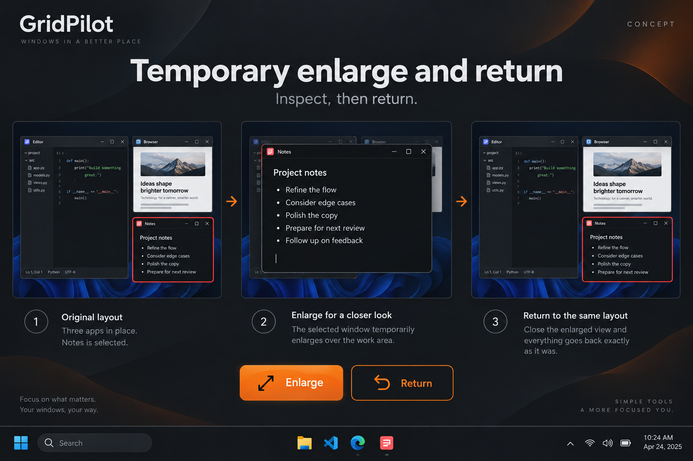

# Temporary enlarge and return: inspect one window without losing its place

GitHub request: https://github.com/arkiental/GridPilot/issues/39



## Summary

A supporting Notes or Browser window is correctly positioned but too small for a brief detailed task. Enlarging it manually loses the exact frame or competes with placement Undo. Provide a reversible, explicit temporary view that enlarges only that window, then returns it.

Requested by the owner as detailed feature request **1** from the 15-idea UX proposal. Creation of this backlog request does not authorize implementation.

## User experience

1. Expose Enlarge temporarily / Return to previous size in Focus and the tray, plus an optional configurable global toggle with no default binding. Global invocation uses the external foreground window; Focus uses its selected target.
2. On Enlarge, capture the exact target identity, visible frame, native restore/maximized state and current monitor work area. Enlarge to a normal frame filling that monitor's work area with configured gaps. Other windows keep their frames and may be covered.
3. Show a session badge and a clearly labeled Return action. A second toggle on the same target returns its original geometry/state and focuses it. Returning does not close the app; the illustration's enlarged view means the real source window.
4. Allow one outstanding temporary enlargement in the MVP. A different target explains which window is enlarged and offers Return existing window or Cancel; never overwrite the snapshot.
5. Keep the return snapshot until native restoration is verified. If the source closes, end that temporary session with an explicit message.

## Behavior, edge cases and scope

- Maintain a dedicated temporary-return transaction separate from ordinary placement Undo. Enlarge and Return must not overwrite or consume the prior Undo record. Unrelated target operations may continue; an action touching the temporarily enlarged window, including ordinary Undo, must offer Return first or Cancel.
- Manual movement/resizing after enlargement must not erase the snapshot. Return remains explicit and explains that it will restore the original frame. Do not enforce the enlarged geometry in the background.
- An already maximized or work-area-filling target produces a clear Already enlarged no-op and preserves existing Undo. Block locked/ineligible/hung/modal-restricted targets with the existing reason.
- Temporary enlargement may cover ordinary unlocked neighbors, but must not overlap any visible Keep here lock belonging to another window. If filling the work area conflicts, explain the named lock and offer Cancel or a separate explicit unlock; do not silently resize or cover the locked window.
- Revalidate HWND+PID, native eligibility and topology before both transitions. Failed enlargement rolls back; failed Return retains the recovery snapshot and permits retry.
- If the original display/work area is unavailable, do not claim exact restoration or silently move to another monitor. Offer a separate reviewed reachable placement or Cancel and retain the snapshot until the user resolves/discards it.
- Session-only state; no app launching or persisted live handles. Shutdown with an outstanding session offers Return and quit, Keep current size and quit, or Cancel; forced termination cannot guarantee restoration. A new session must not guess a prior binding.

## Relationship to existing work

Build on verified placement and Undo (#8, #26). This is a single temporary return point, distinct from Layout Timeline (#18), saved scenes (#15), and persistent app rules.

## Acceptance criteria

- [ ] Enlarge Notes in a three-window arrangement and Return restores its exact prior frame while both neighbors remain unchanged.
- [ ] A prior ordinary Undo record is still available after a successful enlarge/return cycle.
- [ ] Repeated toggles never replace the original snapshot with the enlarged frame; a second target cannot silently take over.
- [ ] Closed/stale targets, user resizing, native refusal, monitor loss and failed restoration follow the documented transitions.
- [ ] Keyboard, tray and Focus routes identify the same intended target and Return never closes the application.
- [ ] A visible locked neighbor blocks a conflicting enlargement, while ordinary unlocked neighbors remain unchanged underneath.

## Feature-specific validation

Core state-machine tests for snapshot ownership, no-op/repeat toggles, Undo interaction, manual movement and stale identity. Owned native fixtures for exact round trip, unchanged neighbors, delayed/refused resize, maximized no-op, source closure and retained retry. Manually check production app focus, optional hotkey and monitor disconnect.

Proposed user-centered success check: A user can inspect a small supporting window and resume its prior arrangement with two invocations and no corrective drag.


## Related requests in this set

- [Keep this window here](https://github.com/arkiental/GridPilot/issues/40)
- [Presentation cleanup and return](https://github.com/arkiental/GridPilot/issues/46)

## Shared implementation and delivery requirements

- Preserve GridPilot's current charcoal/orange Focus shell and red selected-window identity. Illustrations are AI-generated interaction concepts, not screenshots or instructions to replace the existing navigation, typography, panel structure or controls. Written requirements take precedence over incidental illustration details.
- Keep physical-pixel placement, explicit HWND+PID identity, monitor work areas, per-monitor DPI, configured gaps, verified native placement and retained recovery snapshots. Cancel stale asynchronous UI work and dispose native resources with their owning surface.
- Provide keyboard operation, visible focus, accessible names and status announcements, high-contrast support, reduced-animation behavior, and usable layouts at small displays and 8K/interface scaling. Do not communicate state through color alone.
- Update README, relevant usage docs and validation notes when implemented. Keep settings migrations backward compatible and local; never persist screenshots, secrets or live handles.
- Implement only after owner approval with `agent:ready`, in a separate issue worktree/branch from fresh `origin/main`; coordinate dependencies and obtain an independent critic review. Open a scoped PR with `Closes #<this issue>`, behavior, validation and material limitations. Do not merge or publish a release.

Required implementation checks:

```text
dotnet build GridPilot.sln -c Release -warnaserror
dotnet run --project tests/GridPilot.Tests -c Release --no-build -- --core
dotnet run --project tests/GridPilot.Tests -c Release --no-build
```

Run the native suite only on a usable Windows desktop using owned disposable fixtures; do not move production windows or inject user-desktop input during unattended testing. Record actual results and remaining mixed-monitor, production-app, RDP and 8K checks as applicable (#19, #20). This issue defines future validation, not a claim those tests have run.
