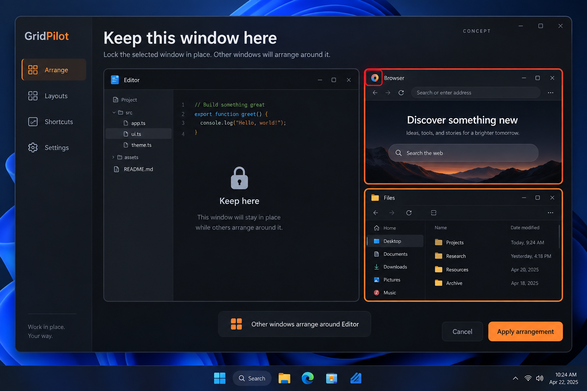

# Keep this window here: session locks that protect occupied space

GitHub request: https://github.com/arkiental/GridPilot/issues/40



## Summary

Users carefully position an editor or call and want to arrange surrounding apps without disturbing or covering it. Auto Arrange exclusion currently leaves a window in place but does not necessarily protect its occupied area. Add an explicit session lock with an obstacle guarantee for new GridPilot proposals.

Requested by the owner as detailed feature request **2** from the 15-idea UX proposal. Creation of this backlog request does not authorize implementation.

## User experience

1. Add Keep this window here to Focus/sidebar and Auto Arrange inspector. The control locks that exact live window's current visible frame without moving it.
2. Show a neutral lock glyph and accessible Locked text on the card/frame; keep red for the active target and orange for proposed geometry.
3. Auto Arrange and selected-window arrangement pack around locked frames. Focus reflow, swaps, splits and dividers may neither move nor introduce new overlap with a lock.
4. A placement targeting a locked window shows Unlock to move and Cancel. Unlock is a deliberate separate action, not an automatic side effect of dragging.
5. Offer Unlock all session locks in a small session-management surface. Locks survive panel close/reopen and end when the source closes or GridPilot exits.

## Behavior, edge cases and scope

- Use HWND+PID plus revalidation; never persist live handles or lock every sibling of the same executable. Lock differs from a saved app place (persistent proportional rule) and exclusion (non-participation).
- Treat the current native rectangle of a visible locked source as a hard obstacle, including intersections with multiple monitors. Respect physical-pixel gaps without double inflation. Handle fixed-size/elevated windows as obstacles even if they cannot be moved.
- Do not continuously force native geometry. If the user/app moves a locked source, invalidate active previews and refresh protection around its new current frame; explain that the lock prevents GridPilot moves, not manual ones.
- Minimizing/hiding/cloaking suspends occupied-space protection while retaining session identity; restoring it reactivates protection and invalidates stale proposals. It must not reserve an invisible historical rectangle.
- Existing overlaps are not repaired automatically. A new proposal must not introduce overlap with a visible lock; explain pre-existing conflicts where they prevent arrangement.
- Saved-place or ratio rules that conflict with a lock produce a specific conflict and require explicit rule/lock changes. A lock must not silently erase saved preferences.
- Recheck locked obstacle identities and bounds at acceptance and during existing guarded placement. Roll back touched targets on detected changes; locks themselves are never rollback participants for new operations.
- If ordinary Undo would move a currently locked source or newly cover its protected area, block with the named conflict and preserve the Undo snapshot until explicit unlock/resolution. Failure recovery for an already-running transaction must complete before a new lock may be created.

## Relationship to existing work

Extends Auto Arrange (#22) and placement interactions (#26); coordinate with Elastic Layouts (#16, #36–#38), Fit into Free Space (#34), and multi-selection. Existing exclusion behavior stays distinct.

## Acceptance criteria

- [ ] Lock Editor, then arrange Browser and Files; Editor remains at exactly the same frame and neither result overlaps it.
- [ ] Normal placement, Auto Arrange, swaps, dividers, splits and selected-window arrangement apply the same lock policy.
- [ ] User movement updates the protected rectangle on refresh/revalidation and stale proposals cannot apply.
- [ ] Two windows of the same app can have different lock states; a recycled handle never inherits a lock.
- [ ] Minimize/restore, close, Unlock all, rule conflicts and Undo conflicts produce the stated behavior.

## Feature-specific validation

Core obstacle geometry with gaps, cross-monitor/negative origins, prior overlaps and saved-rule conflicts; session state/identity tests. Owned fixtures for unchanged locked geometry, late obstacle movement, minimization/restoration, closure and every placement entry point. Check visible lock labels, keyboard access and mixed DPI manually where available.

Proposed user-centered success check: A user protects one important app and safely arranges its neighbors without inspecting each proposal for accidental displacement or coverage.


## Related requests in this set

- [Temporary enlarge and return](https://github.com/arkiental/GridPilot/issues/39)
- [Arrange selected windows](https://github.com/arkiental/GridPilot/issues/43)
- [Presentation cleanup and return](https://github.com/arkiental/GridPilot/issues/46)
- [Restore and place minimized windows](https://github.com/arkiental/GridPilot/issues/47)

## Shared implementation and delivery requirements

- Preserve GridPilot's current charcoal/orange Focus shell and red selected-window identity. Illustrations are AI-generated interaction concepts, not screenshots or instructions to replace the existing navigation, typography, panel structure or controls. Written requirements take precedence over incidental illustration details.
- Keep physical-pixel placement, explicit HWND+PID identity, monitor work areas, per-monitor DPI, configured gaps, verified native placement and retained recovery snapshots. Cancel stale asynchronous UI work and dispose native resources with their owning surface.
- Provide keyboard operation, visible focus, accessible names and status announcements, high-contrast support, reduced-animation behavior, and usable layouts at small displays and 8K/interface scaling. Do not communicate state through color alone.
- Update README, relevant usage docs and validation notes when implemented. Keep settings migrations backward compatible and local; never persist screenshots, secrets or live handles.
- Implement only after owner approval with `agent:ready`, in a separate issue worktree/branch from fresh `origin/main`; coordinate dependencies and obtain an independent critic review. Open a scoped PR with `Closes #<this issue>`, behavior, validation and material limitations. Do not merge or publish a release.

Required implementation checks:

```text
dotnet build GridPilot.sln -c Release -warnaserror
dotnet run --project tests/GridPilot.Tests -c Release --no-build -- --core
dotnet run --project tests/GridPilot.Tests -c Release --no-build
```

Run the native suite only on a usable Windows desktop using owned disposable fixtures; do not move production windows or inject user-desktop input during unattended testing. Record actual results and remaining mixed-monitor, production-app, RDP and 8K checks as applicable (#19, #20). This issue defines future validation, not a claim those tests have run.
