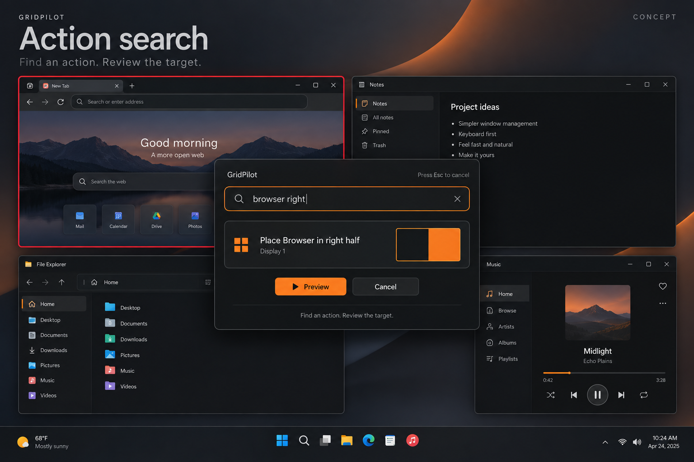

# Action search: find window actions and placements from one command palette

GitHub request: https://github.com/arkiental/GridPilot/issues/41



## Summary

Useful commands are distributed among Focus, More, the tray and Settings. Add a local keyboard-first action search that turns a query such as browser right into an explicit target/action/destination choice.

Requested by the owner as detailed feature request **5** from the 15-idea UX proposal. Creation of this backlog request does not authorize implementation.

## User experience

1. Add a labeled Actions button and Ctrl+K while Focus has focus. Keep Ctrl+F for window search and existing text-editing shortcuts unchanged. An optional global launcher can be assigned through normal conflict validation; none is assigned by default.
2. Index available commands, built-in placements, saved placement names, app/window names and display labels. Use deterministic local token matching and a small documented alias set (for example right/right half), with exact names ranked above aliases.
3. Show each result's action, specific window title/app, destination display, placement glyph and shortcut if assigned. List ambiguous same-app targets separately; never act on the first title match silently.
4. Typing and navigating results only previews metadata. Enter or Preview on a placement result opens the normal orange geometry preview; a distinct Apply commits. Non-moving commands such as Open settings can execute from their labeled result.
5. Esc closes the palette first and preserves the underlying panel/selection; the next Esc follows existing Focus cancellation. Opening global search captures its external target before taking focus.
6. Provide empty-query recent commands without window-title persistence, no-result guidance, and disabled results with concrete reasons such as Window closed or Display disconnected.

## Behavior, edge cases and scope

- No cloud model, arbitrary natural-language execution, shell commands, scripts, network requests or app launching. Search resolves only a registered allowlist of existing commands and aliases.
- Keep each command's existing validation and transaction semantics. Search must not bypass identity, locks, minimums, occupancy checks, shortcut rules or preview requirements.
- Capture a live catalog generation; cancel/discard stale asynchronous results when search changes or closes. Before preview and apply, revalidate exact HWND+PID and resolved display.
- Use transient window titles for display/search only. Persist at most a bounded list of command/preset IDs; clear stale IDs when a preset is deleted. Do not persist raw typed queries or window content.
- Result selection must not move focus into an app until the explicit action calls for it. Preserve visible keyboard focus, screen-reader result count and selected-item announcements.
- Show a truthful unavailable state for optional future features; do not display commands as operational before their implementation exists.

## Relationship to existing work

Use existing sidebar window search, saved placement editor (#32), and placement service. This is an action discovery surface, not a replacement for window-only search or a free-form agent.

## Acceptance criteria

- [ ] Typing browser right yields specific eligible Browser windows and a right-half preview on the identified display.
- [ ] Typing a saved placement name finds the same placement and monitor semantics as More.
- [ ] Typing, highlighting, cancelling and no-match searches move no native windows and preserve Undo.
- [ ] Two same-app windows require an unambiguous explicit result; a window closing mid-search is never replaced by another target.
- [ ] Ctrl+K, Ctrl+F, text Undo, arrows, Enter and Escape work without shortcut conflicts; no network traffic is introduced.

## Feature-specific validation

Core search ranking, aliases, result deduplication, ambiguous targets, bounded recent IDs and stale generation tests. WPF keyboard/accessibility fixtures plus native target/preview/apply integration using owned windows. Measure search responsiveness against a dense synthetic command/window catalog; document actual results.

Proposed user-centered success check: A user can discover and invoke a named placement without knowing which menu contains it, while always seeing the target and destination.


## Related requests in this set

- [Drag sidebar cards into place](https://github.com/arkiental/GridPilot/issues/42)
- [Favorite and recent placements](https://github.com/arkiental/GridPilot/issues/45)
- [Restore and place minimized windows](https://github.com/arkiental/GridPilot/issues/47)

## Shared implementation and delivery requirements

- Preserve GridPilot's current charcoal/orange Focus shell and red selected-window identity. Illustrations are AI-generated interaction concepts, not screenshots or instructions to replace the existing navigation, typography, panel structure or controls. Written requirements take precedence over incidental illustration details.
- Keep physical-pixel placement, explicit HWND+PID identity, monitor work areas, per-monitor DPI, configured gaps, verified native placement and retained recovery snapshots. Cancel stale asynchronous UI work and dispose native resources with their owning surface.
- Provide keyboard operation, visible focus, accessible names and status announcements, high-contrast support, reduced-animation behavior, and usable layouts at small displays and 8K/interface scaling. Do not communicate state through color alone.
- Update README, relevant usage docs and validation notes when implemented. Keep settings migrations backward compatible and local; never persist screenshots, secrets or live handles.
- Implement only after owner approval with `agent:ready`, in a separate issue worktree/branch from fresh `origin/main`; coordinate dependencies and obtain an independent critic review. Open a scoped PR with `Closes #<this issue>`, behavior, validation and material limitations. Do not merge or publish a release.

Required implementation checks:

```text
dotnet build GridPilot.sln -c Release -warnaserror
dotnet run --project tests/GridPilot.Tests -c Release --no-build -- --core
dotnet run --project tests/GridPilot.Tests -c Release --no-build
```

Run the native suite only on a usable Windows desktop using owned disposable fixtures; do not move production windows or inject user-desktop input during unattended testing. Record actual results and remaining mixed-monitor, production-app, RDP and 8K checks as applicable (#19, #20). This issue defines future validation, not a claim those tests have run.
