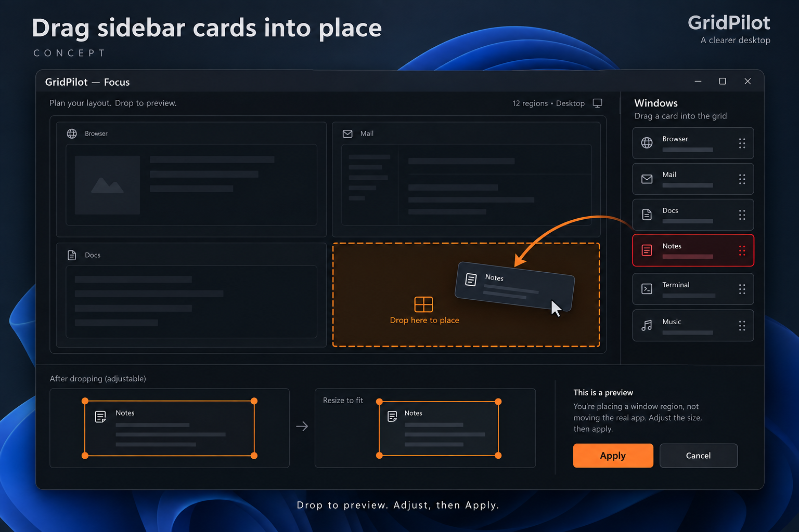

# Drag sidebar cards into Focus: select a window and draw its destination

GitHub request: https://github.com/arkiental/GridPilot/issues/42



## Summary

Placing a different window requires selecting its sidebar card and beginning a separate grid gesture. Add direct card dragging that previews a destination, with an explicit adjustment/commit stage so interior rectangles are reachable.

Requested by the owner as detailed feature request **6** from the 15-idea UX proposal. Creation of this backlog request does not authorize implementation.

## User experience

1. Keep ordinary card click as select-only. A primary-button drag begins only after the system drag threshold; mouse-down alone never moves or resizes anything.
2. After crossing the threshold, select that exact source and show its app/title. Red identifies its original frame. Drag a movable proposed footprint into the grid; do not anchor the rectangle on the first edge cell crossed.
3. Initialize the footprint from the source frame's normalized width/height on its source work area, mapped to the chosen destination. The pointer carries its center; position snaps to the existing grid and clamps within usable bounds. Show dimensions and all affected reflow windows. Hard constraints may make the footprint unavailable, never silently smaller than a minimum.
4. Release inside the grid stages that destination without moving native windows. The user can move or resize the staged rectangle using grid-aligned handles/keyboard controls, or redraw it with the existing grid gesture. A clearly labeled Apply commits; Cancel discards it.
5. Releasing outside the grid, Escape, lost capture, panel close or source/topology invalidation cancels the card gesture/draft. Leaving and re-entering simply moves the floating footprint; it never forces an edge anchor.
6. Preserve click-card then standard grid drawing as a direct alternative. In a staged card-drag draft, grid drawing edits the draft and release does not bypass Apply. A visible hint says Drop to preview. Adjust, then Apply.

## Behavior, edge cases and scope

- Limit MVP to the ordinary Focus sidebar into its currently selected destination display. Do not replace Auto Arrange's tile swap or Shift-split gestures or add cross-display dragging yet.
- Plain primary card dragging has this meaning. Alt/Shift do not switch it to swap or split; show the same preview and retain modifiers only for documented keyboard geometry controls. Auto Arrange gestures remain unchanged.
- Preserve sidebar scrolling: dragging the scrollbar does not start placement; wheel scrolling before threshold retains normal behavior. Native thumbnail hit areas must map to their containing cards.
- The captured source uses HWND+PID, never title matching. Closed, blocked, elevated or stale targets explain the restriction and cannot fall through to another card.
- Dragging and dropping change no native window before Apply. Cancellation preserves the last Undo record and restores pre-gesture target selection where still valid; successful placement follows existing selected-app focus and panel-close preferences.
- Apply uses normal Focus overlap-reflow, session locks, gaps, work-area bounds, DPI and native verification. An infeasible staged destination remains visibly refused and cannot commit. No native window moves until Apply.
- Cancel on monitor/work-area changes, filter/catalog replacement or source invalidation. Release capture and drag visuals on every exit path; avoid screenshot recapture/native minimum queries for each pointer event.
- Source footprint mapping is a starting suggestion, not an aspect lock: use captured native visible size normalized by source work area, then apply destination gaps once via the existing region model. A locked ratio/fixed place must still pass existing proposal validation. Provide exact reproducible rounding tests; no inaccessible off-grid edge anchor is required.

## Relationship to existing work

Build on Focus placement/reflow (#26), integrated sidebar (#7, #14), and existing keyboard rectangle selection. Auto Arrange Shift-drag (#30) remains a different documented surface.

## Acceptance criteria

- [ ] Drag Notes to an interior lower-right destination, drop, adjust its rectangle and Apply; the expected frame and displayed reflow commit as one Undo group.
- [ ] A click, sub-threshold movement or sidebar scroll remains selection/scrolling and causes no placement.
- [ ] Interior destinations, leave/re-enter, footprint positioning, handle resizing and redraw are reachable; outside release cancels and dropping never commits.
- [ ] Escape/capture loss/stale source/topology change leave windows and Undo unchanged and remove drag visuals.
- [ ] The keyboard alternative can produce the same rectangle, and DWM thumbnail input never swallows the card gesture.

## Feature-specific validation

Core footprint mapping/rounding, pointer-to-grid geometry and staged gesture transitions across negative origins and interface/DPI scales. Owned WPF/native fixtures for click-vs-drag, thumbnail hit testing, arbitrary interior destinations, drop-without-move, adjust/Apply/cancel, reflow/Undo, native refusal and stale sources. Manual pointer ergonomics on small and 8K displays.

Proposed user-centered success check: A user can drag a different window to a visible proposed destination, adjust it directly, and commit without ambiguity about which source or rectangle will move.


## Related requests in this set

- [Keep this window here](https://github.com/arkiental/GridPilot/issues/40)
- [Arrange selected windows](https://github.com/arkiental/GridPilot/issues/43)
- [Restore and place minimized windows](https://github.com/arkiental/GridPilot/issues/47)

## Shared implementation and delivery requirements

- Preserve GridPilot's current charcoal/orange Focus shell and red selected-window identity. Illustrations are AI-generated interaction concepts, not screenshots or instructions to replace the existing navigation, typography, panel structure or controls. Written requirements take precedence over incidental illustration details.
- Keep physical-pixel placement, explicit HWND+PID identity, monitor work areas, per-monitor DPI, configured gaps, verified native placement and retained recovery snapshots. Cancel stale asynchronous UI work and dispose native resources with their owning surface.
- Provide keyboard operation, visible focus, accessible names and status announcements, high-contrast support, reduced-animation behavior, and usable layouts at small displays and 8K/interface scaling. Do not communicate state through color alone.
- Update README, relevant usage docs and validation notes when implemented. Keep settings migrations backward compatible and local; never persist screenshots, secrets or live handles.
- Implement only after owner approval with `agent:ready`, in a separate issue worktree/branch from fresh `origin/main`; coordinate dependencies and obtain an independent critic review. Open a scoped PR with `Closes #<this issue>`, behavior, validation and material limitations. Do not merge or publish a release.

Required implementation checks:

```text
dotnet build GridPilot.sln -c Release -warnaserror
dotnet run --project tests/GridPilot.Tests -c Release --no-build -- --core
dotnet run --project tests/GridPilot.Tests -c Release --no-build
```

Run the native suite only on a usable Windows desktop using owned disposable fixtures; do not move production windows or inject user-desktop input during unattended testing. Record actual results and remaining mixed-monitor, production-app, RDP and 8K checks as applicable (#19, #20). This issue defines future validation, not a claim those tests have run.
