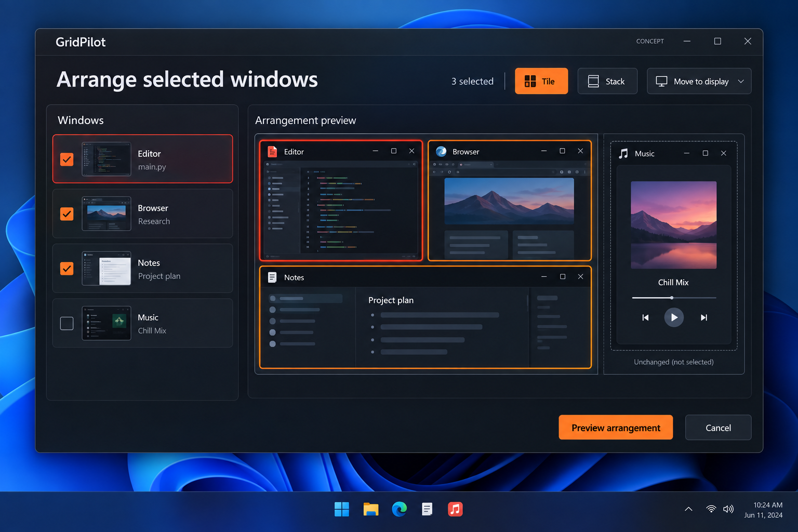

# Arrange selected windows: tile, stack or move a chosen group

GitHub request: https://github.com/arkiental/GridPilot/issues/43



## Summary

Users often need to organize three related apps while leaving the rest of the desktop untouched. Add an explicit selection set and scoped group actions instead of requiring whole-display Auto Arrange or repeated single-window moves.

Requested by the owner as detailed feature request **8** from the 15-idea UX proposal. Creation of this backlog request does not authorize implementation.

## User experience

1. Add an accessible Select multiple control to the Focus sidebar. In that mode, show checkboxes; Ctrl-click toggles membership and Space toggles the focused checkbox. Outside it, card click retains current select-one behavior.
2. Show a persistent selected count, Clear selection and the active window separately. Use checks/neutral outlines for membership; red continues to identify the single active target.
3. Offer Tile (balanced non-overlapping frames), Stack (top-to-bottom non-overlapping rows, not overlapping cascades), and Move to display. Start with 2–16 eligible visible windows on one source display.
4. Tile/Stack defaults to the selected windows' bounding rectangle clipped to the chosen display work area; allow drawing a larger region before preview. Unselected live windows remain hard obstacles, even inside that region.
5. Move to display requires an explicit connected destination. Translate the group's relative geometry to that work area, allowing one uniform scale reduction if needed, while satisfying all hard rules. If it cannot fit without overlaps, offer a separate explicit Tile selection preview on that display; never silently rearrange into another mode.
6. Preview every affected frame and list group members before Apply. A successful operation creates one grouped Undo; Cancel changes no window.

## Behavior, edge cases and scope

- Never include or move an unselected window through Focus reflow. Unselected visible windows, locked windows and relevant reservations are obstacles. Preserve each unselected frame/state exactly.
- Selection is a session set of exact HWND+PID identities. Filtering may hide members but must show an explicit hidden-selected count and a Review selection list; do not silently drop or invisibly add members.
- A source closing or becoming ineligible invalidates the draft and requires the user to review the reduced/blocked membership before Apply. No substitution by same-app title.
- Tile and Stack enforce gaps, work-area bounds, native/saved minimums, locked ratios, saved places and session locks. Do not move a fixed place across displays unless the user explicitly clears/reassigns that rule first.
- Physical geometry uses destination DPI and current monitor work areas, including negative origins. Group translation/scaling must have deterministic rounding and no cumulative gap drift. Reject initially overlapping geometry for Move to display unless the user chooses a fresh Tile/Stack proposal.
- Preflight all members, revalidate membership and relevant occupancy before acceptance, then reuse serialized batch placement and verified rollback. One refusal rolls touched members back; retain uncertain recovery snapshots.
- An active temporary enlargement affecting a group member must be resolved before proposal. Cross-source-display groups, persistent linked groups and automatic app membership are deferred.
- Escape first cancels the group draft; a subsequent Escape exits selection mode. All actions remain keyboard accessible and maintain current panel lifecycle preferences.

## Relationship to existing work

Reuse Auto Arrange (#22), verified batch placement (#26), and lock/comfort preferences when available. This adds scoped membership; it does not implement persistent workspace scenes (#15).

## Acceptance criteria

- [ ] Tile Editor, Browser and Notes while Music is unselected; Music's frame/state remain unchanged and uncovered by new placement.
- [ ] Stack produces distinct vertical rows; a too-small region explains the limiting app and applies nothing.
- [ ] Move a fitting group to another display while preserving relative geometry; an infeasible move offers an explicit alternative instead of changing mode.
- [ ] Hidden selections remain visible in the count/review list; a stale source blocks Apply without choosing a replacement.
- [ ] Successful application has one grouped Undo; cancellation/refusal/rollback preserve the documented state.

## Feature-specific validation

Core membership, row/tile planning, obstacle clipping, group translation/uniform scaling and rounding tests across gaps and DPI. Owned fixtures for unchanged unselected apps, hidden selection review, refusal/rollback, stale members, locked targets and grouped Undo. Manually verify Ctrl-click/checkbox usability and mixed-monitor moves.

Proposed user-centered success check: A user organizes one task's apps in a single reviewed transaction without repairing unrelated windows.


## Related requests in this set

- [Keep this window here](https://github.com/arkiental/GridPilot/issues/40)
- [Comfortable app sizes](https://github.com/arkiental/GridPilot/issues/44)
- [Compare layout alternatives](https://github.com/arkiental/GridPilot/issues/48)

## Shared implementation and delivery requirements

- Preserve GridPilot's current charcoal/orange Focus shell and red selected-window identity. Illustrations are AI-generated interaction concepts, not screenshots or instructions to replace the existing navigation, typography, panel structure or controls. Written requirements take precedence over incidental illustration details.
- Keep physical-pixel placement, explicit HWND+PID identity, monitor work areas, per-monitor DPI, configured gaps, verified native placement and retained recovery snapshots. Cancel stale asynchronous UI work and dispose native resources with their owning surface.
- Provide keyboard operation, visible focus, accessible names and status announcements, high-contrast support, reduced-animation behavior, and usable layouts at small displays and 8K/interface scaling. Do not communicate state through color alone.
- Update README, relevant usage docs and validation notes when implemented. Keep settings migrations backward compatible and local; never persist screenshots, secrets or live handles.
- Implement only after owner approval with `agent:ready`, in a separate issue worktree/branch from fresh `origin/main`; coordinate dependencies and obtain an independent critic review. Open a scoped PR with `Closes #<this issue>`, behavior, validation and material limitations. Do not merge or publish a release.

Required implementation checks:

```text
dotnet build GridPilot.sln -c Release -warnaserror
dotnet run --project tests/GridPilot.Tests -c Release --no-build -- --core
dotnet run --project tests/GridPilot.Tests -c Release --no-build
```

Run the native suite only on a usable Windows desktop using owned disposable fixtures; do not move production windows or inject user-desktop input during unattended testing. Record actual results and remaining mixed-monitor, production-app, RDP and 8K checks as applicable (#19, #20). This issue defines future validation, not a claim those tests have run.
