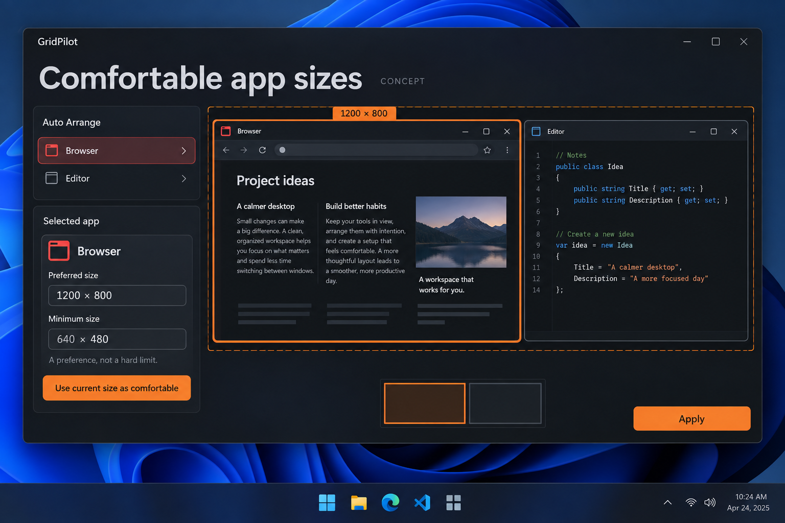

# Comfortable app sizes: soft preferred dimensions for Smart layouts

GitHub request: https://github.com/arkiental/GridPilot/issues/44



## Summary

Native minimum sizes only establish what an app accepts, not what a user can comfortably read or operate. Let users save a comfortable frame size that influences Smart layout ranking without becoming a new hard constraint.

Requested by the owner as detailed feature request **9** from the 15-idea UX proposal. Creation of this backlog request does not authorize implementation.

## User experience

1. In Auto Arrange's selected-app inspector add Use current size as comfortable. Read the live source frame, not its cropped preview, and show the resulting preferred width/height.
2. Expose labeled Preferred width/height fields in logical pixels with a destination physical-pixel equivalent. Keep Detected minimum and explicit Minimum frame visually and semantically separate.
3. Offer Use current size, Reset to automatic, and the existing Remember/Save rules only workflow. Editing the preference updates the draft; no native window moves before Accept.
4. Smart proposals prefer keeping each app near or above its comfortable width/height. When hard constraints or competing preferences require less, show Below preferred size and the dimensions without treating it as invalid.
5. Explain which rules win: native/user hard minimums, fixed places, ratios, locks and work-area bounds first; comfortable dimensions and existing role/space weight affect ranking only.
6. Equal tiles remains equal and does not optimize comfort, but can show the informational below-preferred indicator.

## Behavior, edge cases and scope

- Store preferred dimensions in device-independent logical units using the captured monitor DPI, then convert to physical pixels for each destination with shared rounding. Existing explicit minimum-frame rules remain physical pixels and must not be migrated into different units.
- Preference belongs to the existing app identity (executable path/package ID), not HWND, document content or window title. Identity-inaccessible apps support session-only preference.
- Validate finite positive bounded values; Reset removes the override. Existing settings with no comfort fields preserve today's behavior and built-in role hints.
- Define deterministic ranking penalties for width and height shortfall without treating preferred area alone as sufficient (a very narrow tall window is not equivalent). Document how this combines with role/space weights and provide stable tie-breaking.
- Saved fixed places may be smaller than a soft preference and remain valid if hard constraints pass. Ratio locks remain exact. Never grow a fixed frame, relax a minimum or reserve empty space solely to satisfy comfort.
- Same-app sibling windows share a persisted preference, matching existing app-rule semantics; conflicting per-window draft values must be resolved explicitly before saving. Do not silently pick the last edited sibling.
- Do not infer readability from screenshots, inspect document text, change application zoom or learn preferences through hidden telemetry.
- Reroll/compare may use comfort scoring, but ordinary exact grid placement, presets, Fill empty slot and Fit into Free Space do not silently resize destinations to satisfy this soft preference.

## Relationship to existing work

Extends Auto Arrange role/weight hints and native minimum detection (#22); coordinate with comparison alternatives. It is distinct from hard minimums, locked ratios and saved app places.

## Acceptance criteria

- [ ] Capture Browser's comfortable size and Smart favors a wider/readable Browser frame where feasible.
- [ ] With insufficient room, the planner still offers a valid layout above hard minimums and clearly marks the unmet preference.
- [ ] A tall narrow frame does not score as equivalent solely because it has the same area.
- [ ] At different destination DPI the logical preference converts predictably, while explicit physical minimums remain unchanged.
- [ ] Reset, Remember off, Save rules only, same-app conflicts and settings migration follow the existing draft/persistence contract.

## Feature-specific validation

Core serialization/migration, DPI conversion, invalid values, scoring order, stable ties, hard-vs-soft precedence and sibling consistency tests. Planner examples comparing default/comfort/no-room cases. Owned fixtures verify saving/previewing does not move sources; manual production-app usability check confirms the preferred size is user-chosen rather than claimed readable by the planner.

Proposed user-centered success check: After setting a comfortable size once, a user needs fewer corrective resizes in repeated Smart arrangements. This is an evaluation goal, not a measured claim.


## Related requests in this set

- [Arrange selected windows](https://github.com/arkiental/GridPilot/issues/43)
- [Compare layout alternatives](https://github.com/arkiental/GridPilot/issues/48)

## Shared implementation and delivery requirements

- Preserve GridPilot's current charcoal/orange Focus shell and red selected-window identity. Illustrations are AI-generated interaction concepts, not screenshots or instructions to replace the existing navigation, typography, panel structure or controls. Written requirements take precedence over incidental illustration details.
- Keep physical-pixel placement, explicit HWND+PID identity, monitor work areas, per-monitor DPI, configured gaps, verified native placement and retained recovery snapshots. Cancel stale asynchronous UI work and dispose native resources with their owning surface.
- Provide keyboard operation, visible focus, accessible names and status announcements, high-contrast support, reduced-animation behavior, and usable layouts at small displays and 8K/interface scaling. Do not communicate state through color alone.
- Update README, relevant usage docs and validation notes when implemented. Keep settings migrations backward compatible and local; never persist screenshots, secrets or live handles.
- Implement only after owner approval with `agent:ready`, in a separate issue worktree/branch from fresh `origin/main`; coordinate dependencies and obtain an independent critic review. Open a scoped PR with `Closes #<this issue>`, behavior, validation and material limitations. Do not merge or publish a release.

Required implementation checks:

```text
dotnet build GridPilot.sln -c Release -warnaserror
dotnet run --project tests/GridPilot.Tests -c Release --no-build -- --core
dotnet run --project tests/GridPilot.Tests -c Release --no-build
```

Run the native suite only on a usable Windows desktop using owned disposable fixtures; do not move production windows or inject user-desktop input during unattended testing. Record actual results and remaining mixed-monitor, production-app, RDP and 8K checks as applicable (#19, #20). This issue defines future validation, not a claim those tests have run.
