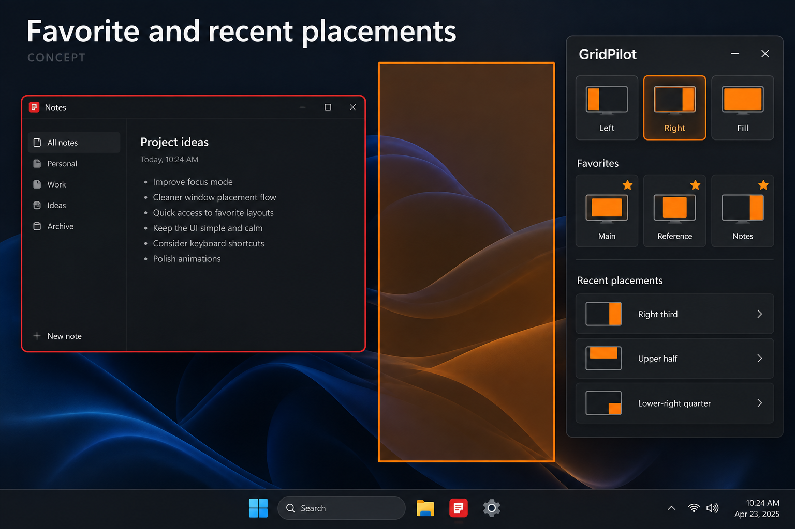

# Favorite and recent placements: fast access to personal layouts

GitHub request: https://github.com/arkiental/GridPilot/issues/45



## Summary

Users with custom saved placements repeatedly open More to use their everyday destinations. Add a small set of pinned placements and a bounded recent-placement list with the same miniature geometry already used in the shortcut editor.

Requested by the owner as detailed feature request **11** from the 15-idea UX proposal. Creation of this backlog request does not authorize implementation.

## User experience

1. Allow Pin to Focus from a saved placement's More entry and Settings → Shortcuts. Show up to four favorites beside the built-in controls when space permits.
2. Each favorite has a placement glyph and accessible name; its tooltip includes the full name, assigned shortcut and display destination. Clicking applies through the exact same selected-target path as the corresponding saved placement.
3. Provide reorder and Unpin controls in Settings. Pin/unpin/reorder in the panel saves atomically; settings-dialog edits remain draft until Save settings, consistent with that surface.
4. More gains Recent placements with up to five distinct successfully applied proportional destinations. A custom grid placement can be reused directly or saved as a named preset through the existing editor.
5. Recent entries show geometry and destination; no application title is persisted. Clear recent placements is available without deleting presets or favorites.
6. On narrow panels, keep built-in actions and move excess favorites into a labeled Favorites overflow. Do not shrink targets or hide placement names from assistive technology.

## Behavior, edge cases and scope

- Reference saved presets by their existing stable PlacementPreset.Id, not list position/name. Preserve valid IDs and current uniqueness validation; do not regenerate IDs. Add backward-compatible optional favorites/recent fields and remove favorite bindings when a preset is deleted.
- Deduplicate recents by normalized rectangle and destination policy. Update ordering only after verified success; failed/cancelled placements, previews and Undo must not create recent entries.
- Record the requested normalized Region before gap inset and native adjustment, together with its destination policy. Replay applies current gaps exactly once; never normalize the final inset native frame and apply a second gap. For an explicit grid drag, store the pre-gap selection proportions and explicit destination display identity. Do not store HWND, PID, screenshot or window title. Saved presets retain current/next/previous/specific-display policies.
- Opening a recent/favorite never silently edits the grid or saved preset. Reuse current gap, constraints, occupancy/reflow, locks and target validation on every invocation.
- A changed grid density must not change the stored rectangle. A missing display follows the same documented policy as its originating saved placement, and the resolved destination is shown before interaction; do not invent a different fallback.
- Favorites are references and recents are bounded reusable geometry, not a second independent preset database. Saving a recent opens the existing editor and requires its normal Save workflow.
- Preserve built-in Left/Right/Fill and Thirds behavior, existing shortcut assignments, theme/high contrast and interface sizing.

## Relationship to existing work

Build on visual shortcuts (#32), saved presets (#3), and Focus controls. This is quick access to placements, distinct from named multi-window scenes (#15) and action search.

## Acceptance criteria

- [ ] Pin, reorder, rename and unpin a custom preset; the correct geometry/destination remains attached after restart.
- [ ] Use a favorite and the matching More item against identical state; both produce the same result and Undo behavior.
- [ ] Only verified successful placements enter the five-item deduplicated recent list; no titles or handles persist.
- [ ] A custom recent can be replayed after grid density changes and saved into the normal preset editor.
- [ ] Small panels, deleted presets, missing displays, malformed settings and migration remain usable and deterministic.
- [ ] Replaying a recent in unchanged monitor/DPI/gap conditions produces identical physical geometry without cumulative inset; changing the gap applies the new inset once.

## Feature-specific validation

Core existing-ID preservation and optional-field migration, reference cleanup, recent deduplication/cap, success-only recording, pre-gap Region replay, destination resolution and settings round trips. WPF layout/keyboard tests at small and large interface sizes; owned native fixture confirms favorite/recent apply and Undo use the existing placement transaction.

Proposed user-centered success check: A user's four most frequent custom placements are available without navigating More, and recent manual geometry can be reused without redrawing.


## Related requests in this set

- [Action search](https://github.com/arkiental/GridPilot/issues/41)

## Shared implementation and delivery requirements

- Preserve GridPilot's current charcoal/orange Focus shell and red selected-window identity. Illustrations are AI-generated interaction concepts, not screenshots or instructions to replace the existing navigation, typography, panel structure or controls. Written requirements take precedence over incidental illustration details.
- Keep physical-pixel placement, explicit HWND+PID identity, monitor work areas, per-monitor DPI, configured gaps, verified native placement and retained recovery snapshots. Cancel stale asynchronous UI work and dispose native resources with their owning surface.
- Provide keyboard operation, visible focus, accessible names and status announcements, high-contrast support, reduced-animation behavior, and usable layouts at small displays and 8K/interface scaling. Do not communicate state through color alone.
- Update README, relevant usage docs and validation notes when implemented. Keep settings migrations backward compatible and local; never persist screenshots, secrets or live handles.
- Implement only after owner approval with `agent:ready`, in a separate issue worktree/branch from fresh `origin/main`; coordinate dependencies and obtain an independent critic review. Open a scoped PR with `Closes #<this issue>`, behavior, validation and material limitations. Do not merge or publish a release.

Required implementation checks:

```text
dotnet build GridPilot.sln -c Release -warnaserror
dotnet run --project tests/GridPilot.Tests -c Release --no-build -- --core
dotnet run --project tests/GridPilot.Tests -c Release --no-build
```

Run the native suite only on a usable Windows desktop using owned disposable fixtures; do not move production windows or inject user-desktop input during unattended testing. Record actual results and remaining mixed-monitor, production-app, RDP and 8K checks as applicable (#19, #20). This issue defines future validation, not a claim those tests have run.
