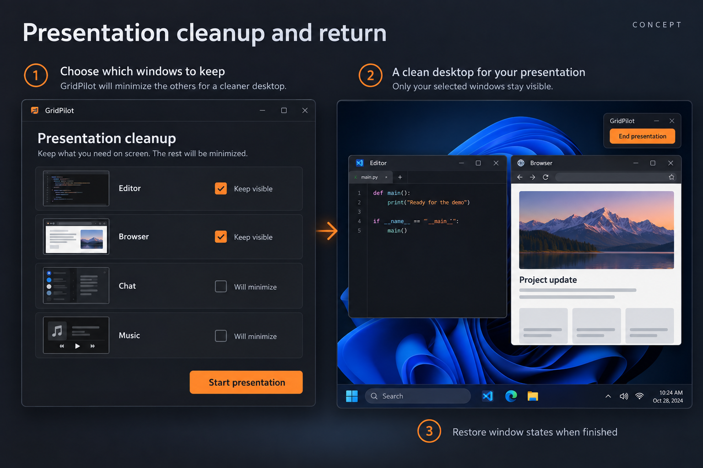

# Presentation cleanup and return: minimize chosen distractions and restore their states

GitHub request: https://github.com/arkiental/GridPilot/issues/46



## Summary

Before a demonstration, users manually minimize unrelated apps and later reconstruct their desktop. Provide a reviewed cleanup action that minimizes explicitly identified windows and restores the states GridPilot changed when the presentation ends.

Requested by the owner as detailed feature request **12** from the 15-idea UX proposal. Creation of this backlog request does not authorize implementation.

## User experience

1. Open Presentation cleanup from Focus/More or the tray. Scope the first release to visible supported app windows on the current virtual desktop across connected displays, with display labels in the list.
2. Start with every window marked Keep visible. Users explicitly uncheck distractions; show Will minimize and a summary count. Already-minimized windows are listed separately as Unchanged, if shown at all.
3. Start presentation revalidates the list and minimizes only those reviewed targets. Capture their exact identity and original WINDOWPLACEMENT/visible frame state before changing them. Kept apps are neither resized nor repositioned.
4. Close the cleanup sheet on success and expose End presentation in the tray and an optional compact movable controller. Background updates do not steal focus.
5. End presentation restores the windows changed by this session, including their original normal/maximized state where supported, and reports closed/unavailable windows. A user can retry unresolved restoration.
6. Permit one active presentation session. Reopening shows its status and End action instead of taking a second snapshot.

## Behavior, edge cases and scope

- This is desktop tidying, not a privacy or screen-sharing protection feature. It does not control notifications, new windows, capture permissions, recording tools, virtual desktops or what another app shares.
- New windows opened after Start remain untouched. Windows the user manually restored or repositioned during the presentation are treated as user-modified and left as-is by default; list them in the End summary with an explicit optional Restore original state action.
- Track only windows GridPilot successfully minimized. Already-minimized windows remain minimized after End; kept windows retain any user edits. Closed targets are skipped and never relaunched or rebound.
- Preflight eligibility and refuse inaccessible/hung/modal-blocked targets with an explanation. If minimization fails mid-batch, roll back successfully touched windows and retain a retry record until recovery is verified; never report a fully clean desktop on partial success.
- Use a dedicated session recovery record so Start/End do not overwrite placement Undo. Placement actions or Undo touching a still-managed minimized target require resolving that session membership first.
- Respect Keep here locks: do not minimize locked windows without an explicit unlock. Resolve active temporary enlargement before Start if its target would be minimized.
- Restore without activating every window in sequence; preserve the user's current foreground where possible. Exact Z-order restoration is not promised. Display changes require a reviewed reachable recovery when old geometry is unavailable.
- Session state is local/in-memory and must not persist live handles. On ordinary quit offer End and quit, Leave minimized and quit, or Cancel; forced termination/crash cannot guarantee automatic restoration.
- No background minimization enforcement, app closing, content capture, Do Not Disturb automation or integration with meeting software in the MVP.

## Relationship to existing work

Reuse placement identity/verification foundations (#26) but implement explicit show-state transaction coverage. Coordinate with temporary enlargement, session locks and minimized-window placement; independent from persistent scenes (#15).

## Acceptance criteria

- [ ] Keep Editor and Browser, minimize Chat and Music, then End; only Chat and Music are restored to their captured states.
- [ ] Already-minimized, newly opened and manually changed windows follow the documented untouched/user-modified policies.
- [ ] Cancel/preview changes no state; a failed Start rolls back touched windows and reports incomplete recovery accurately.
- [ ] Placement Undo survives the session, conflicting operations are explicit, and a second Start cannot overwrite recovery.
- [ ] Tray/controller, keyboard navigation, closed sources, monitor loss and shutdown choices remain usable.

## Feature-specific validation

Core session membership/state ownership, user-modification, single-session and recovery tests. Owned native fixtures for normal/maximized minimization and return, pre-minimized exclusion, partial refusal, source closure, focus preservation and retained recovery. Manual production-app/show-state and multiple-display checks. Verify no notifications/sharing guarantees appear in UI copy.

Proposed user-centered success check: A user can tidy a desktop and resume afterward without manually locating each window that GridPilot minimized.


## Related requests in this set

- [Temporary enlarge and return](https://github.com/arkiental/GridPilot/issues/39)
- [Keep this window here](https://github.com/arkiental/GridPilot/issues/40)
- [Restore and place minimized windows](https://github.com/arkiental/GridPilot/issues/47)

## Shared implementation and delivery requirements

- Preserve GridPilot's current charcoal/orange Focus shell and red selected-window identity. Illustrations are AI-generated interaction concepts, not screenshots or instructions to replace the existing navigation, typography, panel structure or controls. Written requirements take precedence over incidental illustration details.
- Keep physical-pixel placement, explicit HWND+PID identity, monitor work areas, per-monitor DPI, configured gaps, verified native placement and retained recovery snapshots. Cancel stale asynchronous UI work and dispose native resources with their owning surface.
- Provide keyboard operation, visible focus, accessible names and status announcements, high-contrast support, reduced-animation behavior, and usable layouts at small displays and 8K/interface scaling. Do not communicate state through color alone.
- Update README, relevant usage docs and validation notes when implemented. Keep settings migrations backward compatible and local; never persist screenshots, secrets or live handles.
- Implement only after owner approval with `agent:ready`, in a separate issue worktree/branch from fresh `origin/main`; coordinate dependencies and obtain an independent critic review. Open a scoped PR with `Closes #<this issue>`, behavior, validation and material limitations. Do not merge or publish a release.

Required implementation checks:

```text
dotnet build GridPilot.sln -c Release -warnaserror
dotnet run --project tests/GridPilot.Tests -c Release --no-build -- --core
dotnet run --project tests/GridPilot.Tests -c Release --no-build
```

Run the native suite only on a usable Windows desktop using owned disposable fixtures; do not move production windows or inject user-desktop input during unattended testing. Record actual results and remaining mixed-monitor, production-app, RDP and 8K checks as applicable (#19, #20). This issue defines future validation, not a claim those tests have run.
