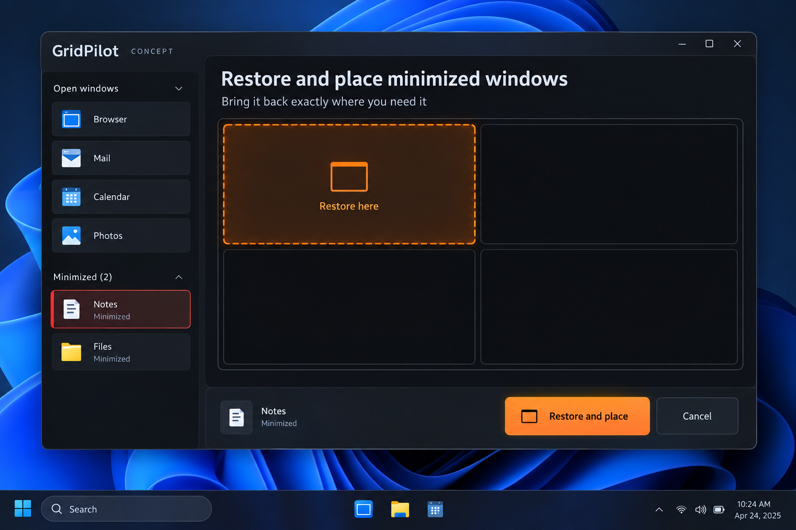

# Restore and place minimized windows from a dedicated sidebar section

GitHub request: https://github.com/arkiental/GridPilot/issues/47



## Summary

The sidebar currently omits minimized windows, forcing users to leave GridPilot, restore an app through the taskbar, reopen Focus and arrange it. Add explicit discovery and restoration without pretending minimized content is a live preview.

Requested by the owner as detailed feature request **13** from the 15-idea UX proposal. Creation of this backlog request does not authorize implementation.

## User experience

1. Add an optional Show minimized windows setting and a collapsible Minimized section below normal live cards. Default it off to preserve current catalog expectations; persist the visibility/collapse preference.
2. Show app icon, current title, display/restore-location context when known and a Minimized label. Use a plain identity row, never a fabricated live thumbnail or a screenshot of stale content.
3. Clicking a minimized row selects that exact source without restoring it. Highlight the row red; the main canvas says Minimized — no current visible frame instead of drawing a false red desktop outline.
4. Choose a grid rectangle or preset to draft a destination. While a minimized source is selected, release/Enter on geometry stages a preview rather than applying; a distinct Restore and place action is required.
5. Restore and place snapshots the original minimized/native restore state, restores the source without intermediate foreground activation where possible, then places it at the reviewed frame through target-only verification.
6. On success, move the source to the normal sidebar and focus it according to existing placement behavior. Undo returns it to its original minimized state and preserves its prior restore frame/maximized restore intent.

## Behavior, edge cases and scope

- Enumerate only supported app windows on the current desktop, excluding shell/tool/owned-popup/other-desktop/cloaked windows according to explicit catalog policy. Do not indiscriminately broaden normal visible-window eligibility.
- Use exact HWND+PID and validate again before restoring and placing. If a source was restored, closed, renamed or changed state externally, refresh its row/draft and require review where geometry/eligibility changed.
- Minimized windows are not occupancy obstacles. All visible neighbors are hard obstacles for this MVP; restore-and-place is target-only and must not trigger ordinary overlap reflow. An occupied destination explains the conflict.
- Query native limits without restoring when possible. If limits are unavailable until restoration, use existing conservative preflight/final verification; never restore merely to generate a preview.
- If restoration or placement fails, return the target to the captured minimized state and restore metadata. Retain recovery/Undo until verification succeeds, with a truthful partial-failure message. Neighbors remain unchanged.
- Maintain the distinction between actual minimized show state, the last normal restore bounds and restore-to-maximized intent; do not treat minimized sentinel coordinates as a real visible frame.
- Revalidate occupancy after restore, since an app can open a dialog or impose new limits. Avoid promising a completely flicker-free OS restore sequence; document actual behavior.
- Do not pull windows from other virtual desktops, launch closed apps or bypass privileges. A presentation-managed window or session-locked source needs explicit session resolution/unlock before this action.
- Dispose/recreate thumbnail resources only when the source becomes a normal eligible visible card; filter/search must include labeled minimized results only when the option is enabled.

## Relationship to existing work

Extends sidebar (#7) and explicit window selection (#6), reusing target-only placement from Partial workspace (#27) and free-space work (#34). It must not silently change ordinary visible-card drag semantics.

## Acceptance criteria

- [ ] Select minimized Notes, preview a vacant rectangle and cancel; Notes stays minimized and ordinary Undo is unchanged.
- [ ] Restore and place produces the reviewed Notes frame without moving neighbors; Undo restores its previous minimized/restore state.
- [ ] No live thumbnail or original-position glow is fabricated for the minimized source.
- [ ] Blocked destinations, newly appearing obstacles, source closure/reuse, external restoration and native refusal produce safe documented transitions.
- [ ] Search, keyboard selection, optional section visibility and current panel close preferences behave consistently.

## Feature-specific validation

Core catalog classification, minimized/normal/maximized state serialization in session snapshots, draft/commit rules and identity transitions. Owned native fixtures for minimized restore-place-Undo, restore-to-maximized metadata, no movement during preview, unchanged neighbors, refusal rollback, dialogs and late occupancy. Manual production-app custom restore behavior and DPI checks.

Proposed user-centered success check: A user can recover and position a minimized app entirely within Focus, with a single explicit restore-and-place commit.


## Related requests in this set

- [Keep this window here](https://github.com/arkiental/GridPilot/issues/40)
- [Presentation cleanup and return](https://github.com/arkiental/GridPilot/issues/46)

## Shared implementation and delivery requirements

- Preserve GridPilot's current charcoal/orange Focus shell and red selected-window identity. Illustrations are AI-generated interaction concepts, not screenshots or instructions to replace the existing navigation, typography, panel structure or controls. Written requirements take precedence over incidental illustration details.
- Keep physical-pixel placement, explicit HWND+PID identity, monitor work areas, per-monitor DPI, configured gaps, verified native placement and retained recovery snapshots. Cancel stale asynchronous UI work and dispose native resources with their owning surface.
- Provide keyboard operation, visible focus, accessible names and status announcements, high-contrast support, reduced-animation behavior, and usable layouts at small displays and 8K/interface scaling. Do not communicate state through color alone.
- Update README, relevant usage docs and validation notes when implemented. Keep settings migrations backward compatible and local; never persist screenshots, secrets or live handles.
- Implement only after owner approval with `agent:ready`, in a separate issue worktree/branch from fresh `origin/main`; coordinate dependencies and obtain an independent critic review. Open a scoped PR with `Closes #<this issue>`, behavior, validation and material limitations. Do not merge or publish a release.

Required implementation checks:

```text
dotnet build GridPilot.sln -c Release -warnaserror
dotnet run --project tests/GridPilot.Tests -c Release --no-build -- --core
dotnet run --project tests/GridPilot.Tests -c Release --no-build
```

Run the native suite only on a usable Windows desktop using owned disposable fixtures; do not move production windows or inject user-desktop input during unattended testing. Record actual results and remaining mixed-monitor, production-app, RDP and 8K checks as applicable (#19, #20). This issue defines future validation, not a claim those tests have run.
