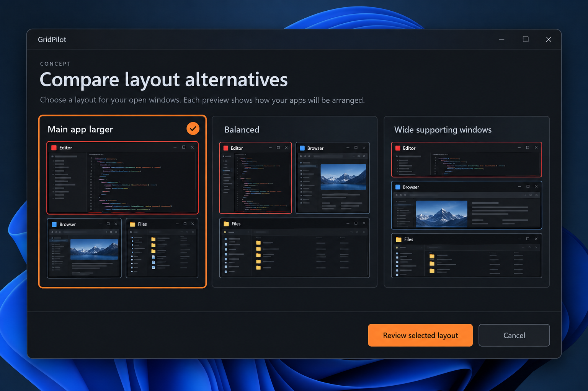

# Compare layout alternatives: review distinct Auto Arrange proposals side by side

GitHub request: https://github.com/arkiental/GridPilot/issues/48



## Summary

Reroll presents alternatives one at a time, requiring users to remember previous geometry. Provide a bounded comparison surface that makes layout tradeoffs visible before selecting a proposal.

Requested by the owner as detailed feature request **15** from the 15-idea UX proposal. Creation of this backlog request does not authorize implementation.

## User experience

1. Add Compare layouts beside Reroll in Auto Arrange. Capture the current draft as the return point and build up to three distinct feasible alternatives from the same catalog, monitor and rule generation.
2. Show labeled cards such as Main app larger, Balanced and Wide supporting windows only when the actual candidate matches that description. Include each window's app name and a compact geometry preview.
3. Selecting a card highlights it but moves no window. Show a short factual tradeoff summary, such as main app frame dimensions or supporting-window widths, rather than a fabricated quality percentage.
4. Review selected layout loads that candidate into the normal full-size editor, where existing swaps/splits/dividers and rules remain available. Accept layout remains the only native apply action.
5. Cancel returns to the exact pre-comparison draft, including manual edits. If that draft became stale due to an external change, retain it as invalid for review rather than pretending it can still apply.
6. If only one or two distinct candidates pass, show only those and explain the limited choice. If none pass, show the relevant conflicts and keep rule editing available.

## Behavior, edge cases and scope

- Use the same hard constraints and participant membership for every candidate: minimums, ratios, saved places/reservations, locks, work area and gaps. A candidate must not gain an advantage by silently dropping a window or relaxing a rule.
- Generate candidates through bounded planner policies with deterministic ranking/tie-breaking. Deduplicate exact physical frames and reject near-identical variants below a documented geometry-difference threshold so the cards represent useful choices.
- Strategy labels describe ranking objectives, not guaranteed area shares. If a policy yields an indistinguishable or misnamed result, omit/relabel it rather than always displaying three branded options.
- Comparison cards use lightweight static geometry, icons and labels; optional already-captured content may be illustrative, not predicted app reflow. Do not multiply all live DWM registrations across three cards. The chosen full editor retains existing live previews.
- Planner work stays cancellable and off the UI thread where appropriate. Closing the panel or changing monitor/catalog/rules discards stale results; do not replace a user's selected candidate with a late result.
- Rule or membership changes invalidate all comparison candidates together. Keep an explicit Rebuild comparisons action after invalidation; native acceptance revalidates identities and occupancy through the existing service.
- Do not automatically save new presets/scenes or change remembered rules when comparing. Comfortable-size preferences may contribute to scoring once implemented, but comparison must work independently without them.
- On small screens use a keyboard-accessible vertical list with comparable preview sizes; preserve labels, selected state and dimensions at large interface scales. Color alone is not enough.
- Comparison generation must not clear ordinary Undo. Applying a chosen result uses the existing grouped Undo and refusal/rollback path.

## Relationship to existing work

Extends Auto Arrange/Reroll (#22) and coexists with Elastic Layouts (#16), Shift-drag (#30) and comfortable-size preferences. It is proposal comparison, not saved scenes or layout history.

## Acceptance criteria

- [ ] With three eligible apps and permissive rules, users can inspect distinct alternatives simultaneously and review the chosen exact geometry in the main editor.
- [ ] Selecting/cancelling/rebuilding moves no native windows and preserves the prior draft/Undo as documented.
- [ ] All displayed candidates satisfy the same hard rules and include the same windows; duplicates and infeasible candidates are not filler cards.
- [ ] One/two/no-candidate cases, stale asynchronous completion and topology changes are handled truthfully.
- [ ] The chosen candidate applies through existing verification and grouped Undo, and comparison thumbnails do not imply future content reflow.

## Feature-specific validation

Core candidate strategy/ranking, membership equality, geometry deduplication, constraint equivalence and generation cancellation tests. WPF fixtures for return-to-draft, selection, small-screen layout and resource ownership. Owned native fixtures for no movement before Accept, exact selected-proposal apply, refusal recovery and Undo. Measure planner latency/resource use with a dense synthetic catalog.

Proposed user-centered success check: A user chooses between useful layouts without repeatedly rerolling and reconstructing the previous arrangement from memory.


## Related requests in this set

- [Arrange selected windows](https://github.com/arkiental/GridPilot/issues/43)
- [Comfortable app sizes](https://github.com/arkiental/GridPilot/issues/44)

## Shared implementation and delivery requirements

- Preserve GridPilot's current charcoal/orange Focus shell and red selected-window identity. Illustrations are AI-generated interaction concepts, not screenshots or instructions to replace the existing navigation, typography, panel structure or controls. Written requirements take precedence over incidental illustration details.
- Keep physical-pixel placement, explicit HWND+PID identity, monitor work areas, per-monitor DPI, configured gaps, verified native placement and retained recovery snapshots. Cancel stale asynchronous UI work and dispose native resources with their owning surface.
- Provide keyboard operation, visible focus, accessible names and status announcements, high-contrast support, reduced-animation behavior, and usable layouts at small displays and 8K/interface scaling. Do not communicate state through color alone.
- Update README, relevant usage docs and validation notes when implemented. Keep settings migrations backward compatible and local; never persist screenshots, secrets or live handles.
- Implement only after owner approval with `agent:ready`, in a separate issue worktree/branch from fresh `origin/main`; coordinate dependencies and obtain an independent critic review. Open a scoped PR with `Closes #<this issue>`, behavior, validation and material limitations. Do not merge or publish a release.

Required implementation checks:

```text
dotnet build GridPilot.sln -c Release -warnaserror
dotnet run --project tests/GridPilot.Tests -c Release --no-build -- --core
dotnet run --project tests/GridPilot.Tests -c Release --no-build
```

Run the native suite only on a usable Windows desktop using owned disposable fixtures; do not move production windows or inject user-desktop input during unattended testing. Record actual results and remaining mixed-monitor, production-app, RDP and 8K checks as applicable (#19, #20). This issue defines future validation, not a claim those tests have run.
