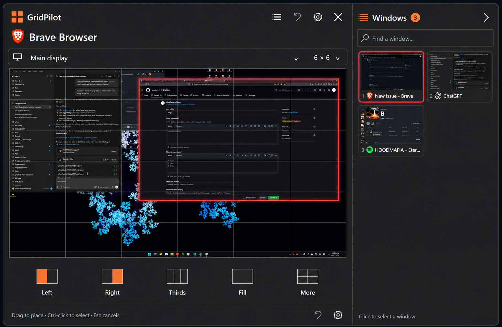
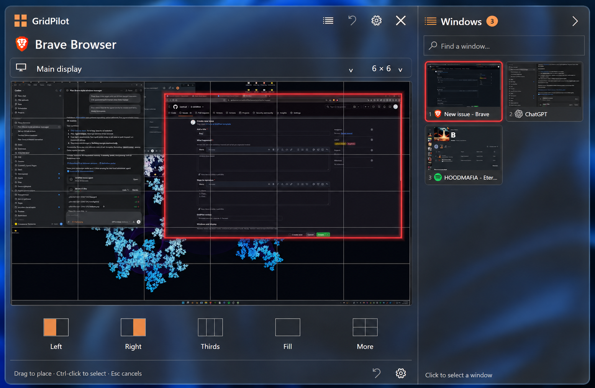
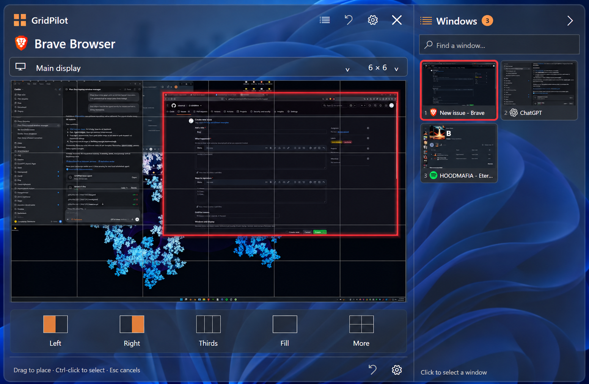
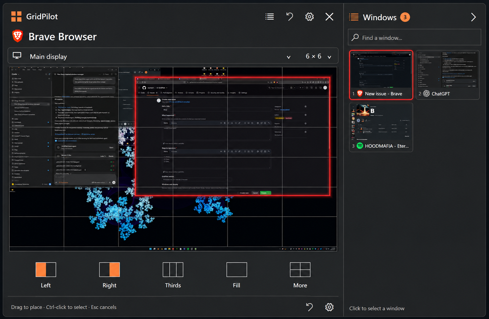
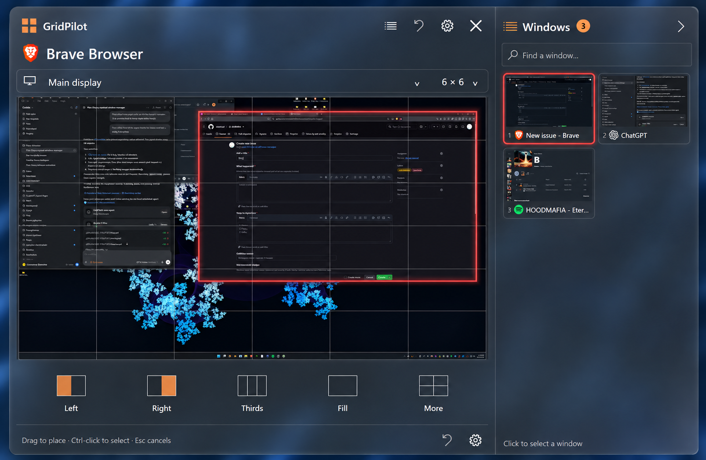

# GridPilot polish concepts — issue #21

Five visual directions for the existing Focus layout. **Concepts only; no app behavior or rendering has been changed.** The owner chooses a direction before implementation.

All directions retain the large desktop preview, 6 × 6 grid, red selected-window marker, app icon/title, attached two-column window sidebar, monitor selector and five preset controls. Generated lettering and fine screenshot detail are illustrative, not implementation specifications.

| Concept | What changes | Tradeoff |
| --- | --- | --- |
| 01 Matte Focus | Cleaner opaque charcoal, precise borders and restrained orange | Safest readability and simplest rendering |
| 02 Smoked Glass | Subtle dark transparency around opaque preview surfaces | Recommended balance; backdrop rendering needs a prototype |
| 03 Half Transparent | Stronger transparency with solid backing behind important controls | Most experimental; busy wallpaper can reduce readability |
| 04 Graphite Edge | Sharper separators and subtle opaque surface hierarchy | Most utilitarian and predictable |
| 05 Soft Acrylic | Softer frosted appearance and gentler chrome | Attractive, but blur/composition cost must be measured |

**Recommendation: 02 Smoked Glass**, with 01 Matte Focus as the opaque fallback. It explores the requested transparency without weakening the desktop preview. Start any approved implementation with a rendering prototype: keep screenshot and native DWM thumbnail content fully opaque, confirm native thumbnail compatibility, and compare open/drag/scroll performance with the opaque baseline. These illustrations cannot establish performance. Opacity figures in prompts describe visual intent, not verified Windows compositor settings.

## Choose a direction

Comment on [issue #21](https://github.com/arkiental/GridPilot/issues/21), for example: “Choose 02, use the border treatment from 04. I approve implementation.” Until then, this is exploration only.

## Matte Focus

## Smoked Glass

## Half Transparent

## Graphite Edge

## Soft Acrylic

## Provenance and validation

- Reference: owner-supplied screenshot in issue #21, saved as [reference.png](reference.png).
- Generated with the built-in imagegen tool, one call per concept; [complete prompts](PROMPTS.md).
- Gallery images reviewed for overall layout, interface palette and selection treatment.
- No source code changed; compilation/native placement tests do not validate these raster concepts and were not run for this design-only change.

