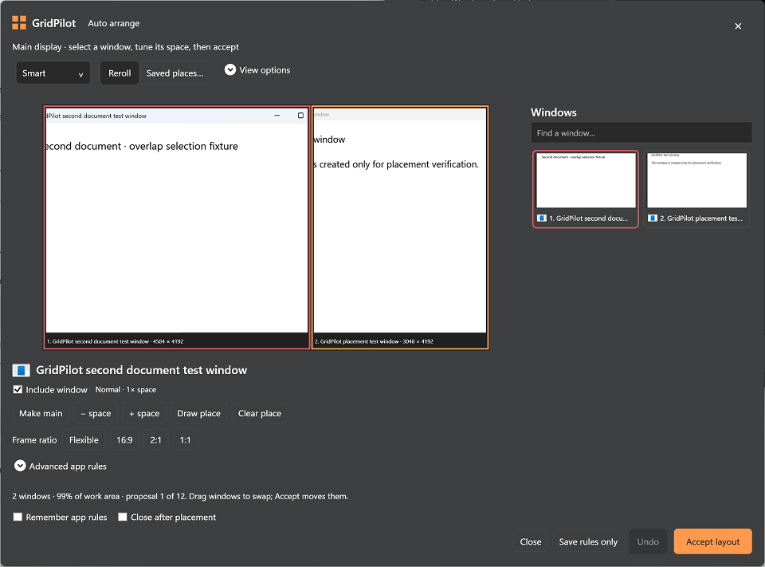
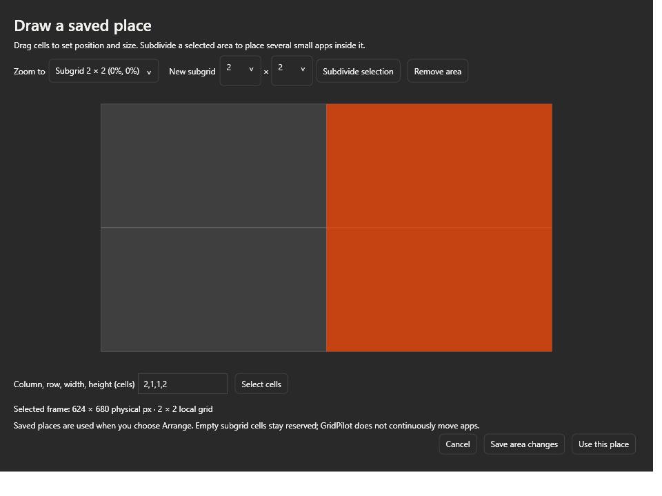

# Automatic arrangement

Open Focus, select a display, then choose **Auto arrange**. The sheet uses the eligible window catalog captured before Focus opened. HWND + PID identifies each move; app identity supplies only remembered preferences. No window moves until **Accept layout**. Up to 32 visible, resizable windows on the selected display can participate. Minimized, other-desktop, hung, modal-blocked, and inaccessible elevated windows are omitted.

## Smart workflow

**Smart** starts with a larger main workspace and smaller supporting windows. Blender and Substance Painter are workspace candidates; Explorer is a utility and Spotify a companion. Unknown apps remain normal. A workspace candidate wins over the pre-panel target; without one, the captured non-utility target or first eligible normal window wins. These are editable assumptions, not knowledge of your document or task. **Make main** overrides the guess for this arrangement. **− space / + space** adjusts a soft weight. **Equal tiles** ignores the role hierarchy.

The bounded planner compares unequal split layouts and an alternate shelf layout. A four-app Blender/Chrome/Explorer/Spotify setup initially targets roughly 60/20/12/8 percent when constraints permit. Minimums, reserved places, locked ratios and shape preferences can change the result. Role preferred sizes are logical sizing hints, not measured native app limits. The planner never silently lowers a minimum, stretches a locked frame or grows a fixed place. Search failure means no suitable candidate was found, not a proof that all possible layouts are impossible.

The plan and two-column window sidebar show live Windows-compositor previews of individual windows. These show current app content cropped to the proposed frame; they do not predict how an app will reflow after resizing. Select a tile or sidebar card to mark it red and show its inspector below the plan. The inspector includes Make main, space weight, ratio presets (16:9, 2:1 and 1:1), advanced rules and drawn places. Protected or unsupported content can be blank while its identity remains visible. Exclusion leaves a window where it is; automatic windows can cover it. An excluded window with a saved place retains its reservation. Ratios and reserved fragments can leave visible unused space.

Use **Reroll** to cycle distinct feasible proposals without moving any windows. Drag one proposed tile onto another to exchange their exact frames. A swap is refused if a saved fixed place, minimum or locked ratio would be violated. **Accept layout** is the explicit move action. The sheet stays open by default; **Close after placement** changes that behavior. **Undo** restores the last available group, including retained snapshots after an incomplete rollback, and remains available when restoration needs a retry. Escape closes the movable sheet. A closed window can still be selected and excluded; a temporary blocking dialog disables acceptance until the window is available again without discarding the proposal.

## Draw a permanent app place

1. Select the intended app, then choose **Draw place** in its inspector below the preview.
2. Drag over the display grid, or enter **column, row, width, height** in cells (one-based) and choose **Select cells**. The editor reports the resulting physical frame dimensions.
3. Choose **Use this place**, inspect the arrangement, and apply with **Remember** enabled.

The place is saved by executable path or packaged-app identity and display device name. Its rectangle is relative to that display's work area, so it follows a resolution/work-area change; its exact physical size is recomputed and shown, including destination-DPI gaps. User minimums remain physical pixels. A changed work area can make a remembered place conflict with a minimum or ratio: the sheet reports that conflict and requires a redraw or rule change, rather than distorting it.

“Permanent” means remembered across GridPilot/app restarts and used the next time you accept an arrangement. It does **not** monitor app launches, move windows continuously, or prevent you moving them manually. Missing apps' saved places remain reserved. **Clear place** releases the app's saved place; it does not delete its parent subgrid. Identity-inaccessible apps can use a place for this session only.

When several windows belong to the same saved app, choose **Use saved place** on the intended window. GridPilot does not guess by title or silently put every sibling in the same rectangle. Other siblings remain automatic. Only live HWND + PID identities are moved; those identities are never persisted.

## Local subgrids

In the drawing editor, select an outer region—such as the top-left cell of a 6 × 6 grid—choose the local column/row count, then **Subdivide selection**. The editor zooms into that area. Draw a child place for Spotify there, then draw another app's place by choosing the same area under **Zoom to**. This also supports a wide strip divided into narrow local slots without increasing the global grid density.

The entire parent area is reserved from automatic packing, including empty cells or absent/excluded apps. **Saved places…** lists closed apps as well as live ones; it can clear an absent app slot or explicitly remove a parent together with all its child places. It also creates reserved subgrids without any app being open. Child boundaries map directly through the parent to the physical work area, with shared gap rounding once. Saved places cannot overlap; a child must remain inside its parent. The editor prevents overlapping parent regions. There are two removal paths: **Saved places… → Remove area + child places** explicitly clears a parent and every child assignment, including closed apps. Within the drawing editor, **Remove area** is deliberately limited: first clear other apps' child places, select the parent, then remove it and keep the area changes. Saving area changes keeps the editor changes in the sheet draft without assigning a window or committing an unfinished drawing. **Save rules only** persists the draft without moving anything, even with no eligible windows or no feasible arrangement. Current support is one level of local subgrids.

## Large-display controls and advanced rules

On very large logical work areas (at least 6000 × 3000), Smart targets a larger main share and gives spare room to the main workspace instead of inflating supporting apps. Minimums and explicit rules still win; 8K usability depends on actual window dimensions, not enlarged controls.

**View options → Interface size** is independent of placement DPI and coordinates. Auto uses 200% UI sizing for work areas at least 6000 pixels wide at up to 125% display scale; other displays use 100%. Explicit 100/150/200/250% choices are available. The sheet is clamped to available screen space, has a scrollable app list, and the drawing editor zooms local areas to make tiny 8K cells usable. UI enlargement never changes the physical placement geometry.

Expand **App rules** for:

- **Aspect:** blank is flexible; `16:9`, `1:1`, or a decimal locks the visible frame, not the internal canvas.
- **Grid shape:** `3x2` derives a physical ratio from the selected display's current outer grid; it overrides Aspect. It is a ratio constraint, distinct from a drawn cell address.
- **Minimum frame:** your explicit lower bound in physical pixels, default `320x240`. Auto arrange also queries each app's native minimum when the editor opens and uses the larger limit. The inspector shows the effective **Detected minimum**; manual entry is unnecessary for reported native limits. Saved manual rules remain unchanged.
- **Role:** Automatic uses the small executable catalog; Workspace, Normal, Utility and Companion override it.

Remember saves rules, places, subgrids and UI size. Same-app siblings need matching ratio/minimum/role/space rules to save them. Make main is a per-preview choice. Persistent exclusion is set only when all windows of the app are excluded. Existing settings migrate with default automatic roles and no places while preserving old ratio/minimum locks. Cancel discards unsaved draft changes; an earlier explicit Save rules only remains saved. Remember off applies the draft only for the current operation unless you explicitly save it.

## Placement safety and limitations

Before enabling **Accept layout**, the editor queries [WM_GETMINMAXINFO](https://learn.microsoft.com/en-us/windows/win32/winmsg/wm-getminmaxinfo) for each captured window without moving or resizing it. Queries run off the UI thread, at most four concurrently, with a 250 ms [SendMessageTimeout](https://learn.microsoft.com/en-us/windows/win32/api/winuser/nf-winuser-sendmessagetimeoutw) bound per app. Closing the editor cancels queued work and discards late results. Exact HWND + PID, current monitor, DPI and frame checks reject stale results. Tracking coordinates become physical pixels, with invisible restored-frame borders removed; maximized windows keep a conservative outer minimum. Failed queries fall back to explicit rules and normal placement verification.

Actual visible bounds are verified after each native move. A refusing/stale target or changed display topology stops the batch and rolls touched windows back using the existing verified restoration path. If an app responds with a stable larger frame at the requested origin, different from its starting frame, GridPilot attempts verified recovery automatically. After all touched windows are restored, Auto arrange uses the observed larger dimensions to rebuild the preview. Review it and press **Accept layout** again; the revised plan is never applied automatically. A successful recovery does not require a separate Undo. If no layout fits (including a saved place that is too small), acceptance is disabled and the conflict is explained.

Detected and observed dimensions belong only to that HWND + PID during the open editor session; they do not overwrite saved minimum rules or affect another document of the same app. Reopening queries native limits again automatically. Apps that omit their native limits or change them dynamically may still need verified placement recovery; an explicit **Minimum frame** can supplement those apps. An unchanged frame may mean a queued native request rather than a genuine minimum, so such failures retain the existing conservative Undo recovery. Failed restoration snapshots remain available for Undo; successful batches create one grouped Undo. Closed windows are skipped during Undo.

One display is arranged per operation. The native display device name is the current monitor key, not a portable physical-monitor serial number: reassigned device names after hardware reconnection require checking the preview. A saved slot reserves space even when its app is absent. The planner uses bounded candidate policies and may leave fragments unused. Real full Spotify windows are not assumed to accept Miniplayer dimensions; GridPilot does not switch app modes.

Research informing the policy is recorded in [the design proposal](AUTO_ARRANGE_PROPOSAL.md), including primary sources for split layouts, logical size hints and hard native acceptance. Relevant Windows contracts: [WM_GETMINMAXINFO](https://learn.microsoft.com/en-us/windows/win32/winmsg/wm-getminmaxinfo), [SetWindowPos](https://learn.microsoft.com/en-us/windows/win32/api/winuser/nf-winuser-setwindowpos), and [DPI-awareness contexts](https://learn.microsoft.com/en-us/windows/win32/hidpi/high-dpi-desktop-application-development-on-windows). Remaining owner checks include actual Blender/Chrome/Spotify/Explorer content, full Spotify versus separately opened Miniplayer, 8K100% ergonomics, mixed-monitor topology changes, RDP and dynamic native minimums. Fixture/core results cannot certify those production-app workflows.

## Reviewed fixture views

The first image captures the owned arrangement window after native composition on the 7680 × 4320 desktop at 200% Windows scaling, with Smoked Glass active and real DWM fixture previews. The named windows are disposable test fixtures, not production apps. The subgrid image is a WPF-only render and excludes native acrylic/titlebar composition. Neither certifies actual 8K100% desktop ergonomics.

## Shift-drag split

Drag an included window from the preview or catalog onto another included window while holding Shift. Four directional target cells choose **left, top, right or bottom**. The highlighted cell and orange outline show the half that the dragged window will occupy; the target takes the opposite half. The target thumbnail is temporarily hidden so the split guide remains visible above native DWM content. Releasing Shift restores normal frame swapping; leaving the target or cancelling clears the guide.

Dropping edits only the proposal. The dragged window's previous area becomes empty; other windows retain their exact frames. Repeat on another frame to subdivide further. Click **Accept layout** to move the windows, then use the existing grouped **Undo** to restore their previous positions. Reroll or changing arrangement rules replaces the edited proposal.

A split uses the configured gap at the target display's DPI and preserves the target frame's outer edges. Minimum sizes, locked ratios and saved places are enforced for both windows; impossible splits show a refusal and leave the proposal unchanged. Clear a saved place before splitting that window. The four cells are directional halves, not quarter-sized destinations or persistent saved subgrids.
