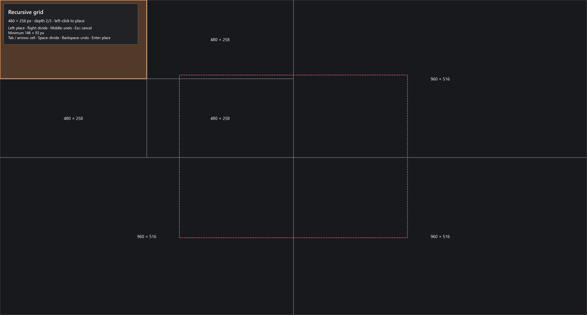
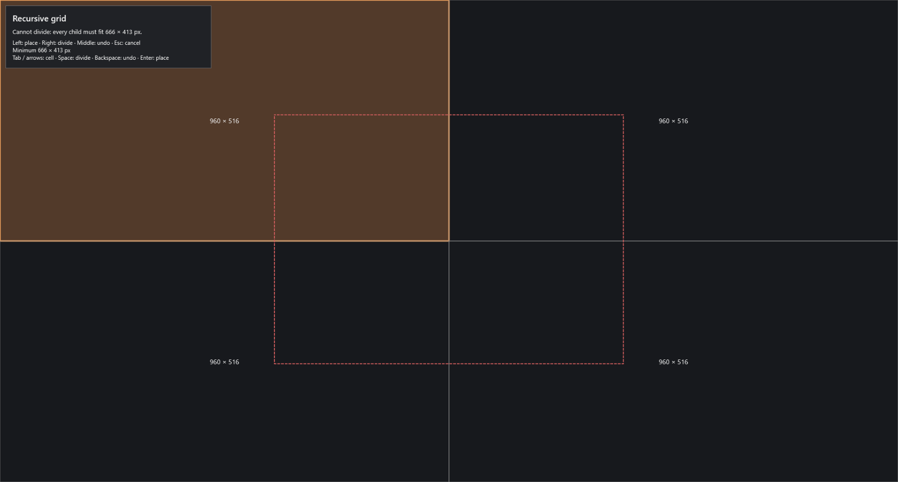

# Recursive grid

Focus a resizable desktop window and press **Ctrl + Alt + G**, or choose **Recursive grid** from the tray. Existing installations keep their previous shortcuts: assign Recursive grid in **Settings → General** if its field is empty. Windows reports unavailable global shortcuts when settings are saved; choose another chord when a different app owns it.

The picker captures the original window by HWND and process ID before opening. Its four initial cells cover that window's monitor work area, excluding the taskbar. The charcoal overlay blocks mouse input within that work area. A red dashed outline marks the captured window; orange highlights the current leaf and labels its physical size.

Captured from the running WPF picker during a disposable-window fixture check; only GridPilot's opaque overlay is rendered, with no unrelated desktop content.

- **Right-click** divides only the leaf under the pointer into another 2×2. Other cells stay where they are.
- **Middle-click** undoes the most recent successful division, across all branches, one step at a time. Rejected divisions add no history. Empty history does nothing.
- **Left-click** moves and resizes the original window into the exact selected leaf. Division and hover never move it.
- **Escape** cancels and returns focus to the original window without moving it.

Keyboard: Tab/Shift+Tab or arrows cycle leaves, Space divides, Backspace undoes a division, and Enter places. The same assigned shortcut dismisses the picker. Once native placement starts, input is held until placement or recovery settles. After a successful placement, the tray's **Undo last placement** restores the previous bounds, including maximized state. Middle-click has no effect after the picker closes.

**Recursive grid maximum depth** persists in Settings → General. Default **4**, range **1–8**; the initial 2×2 is depth **1**. At depth 4 a repeatedly divided branch can reach 1/16 of the work area's width and height. Division stops earlier when any child would be smaller than the target's supported minimum. Cells below the minimum cannot be selected either. Shared edges use integer physical-pixel boundaries, so odd widths, negative display coordinates and edge pixels are retained without gaps. This picker uses exact cells with no configured placement gap.

GridPilot reads `WM_GETMINMAXINFO` in a background query with a **250 ms** timeout and checks the system tracking floor. Reported outer-window limits are converted for monitor DPI and the current invisible frame margins; maximized limits retain conservative outer dimensions before restore. If the query is unavailable, the current restored visible size is the conservative minimum; a maximized window uses its saved restored outer size without restoring merely to measure it. The hint identifies this estimate. This can block cells an application would otherwise accept.

Fixed-size, minimized, disabled, unresponsive, stale or inaccessible windows are refused with an explanation. Maximized windows restore only on commit. Some applications enforce additional or changing size/position rules outside Win32 tracking limits. Native placement verifies the exact visible frame and attempts verified restoration when an app refuses it; the picker reports failure, and any learned larger minimum disables unsafe cells. Recovery that cannot be verified remains available through ordinary Undo. A changed target or display requires opening the picker again.

The existing Focus grid and Draw placement remain separate commands. Real multi-monitor/mixed-DPI hardware, protected/elevated production apps, RDP and assistive-technology behavior require manual checks; fixture and mathematical coverage do not guarantee every application follows the same minimum rules.
