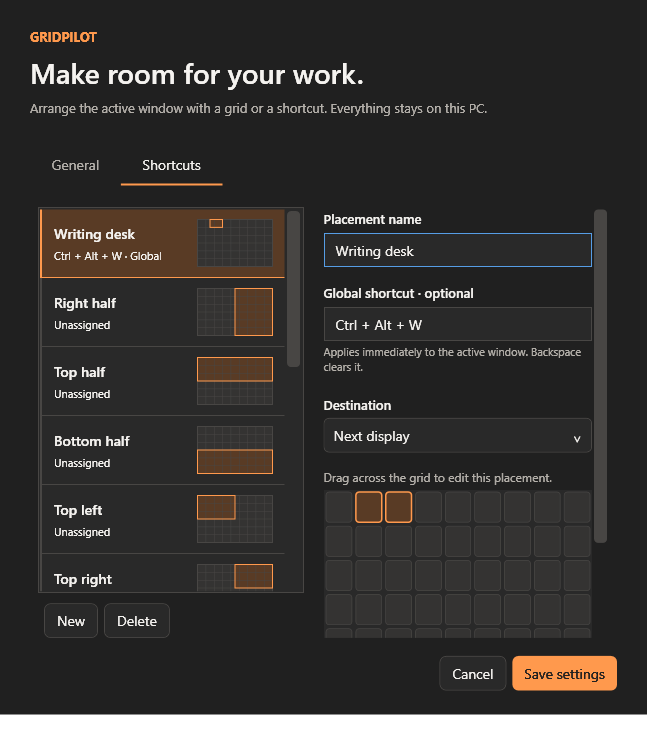

# Validation

## Fit into free space (issue #34)

On 2026-09-27, the Release build with `-warnaserror` completed with zero warnings/errors; core checks passed **5,127 assertions**. The focused `dotnet run --project tests/GridPilot.Tests -c Release --no-build -- --free-space` suite passed **5,149 assertions** on one **1920 × 1080 display at 100%**. No mouse or keyboard input was injected; placement tests moved only their owned fixtures.

Core coverage includes exhaustive small-coordinate largest-rectangle comparison, empty/full displays, overlapping and duplicate obstacles, arbitrary edges, narrow fragments, touching edges, zero/nonzero gaps, negative origins, cross-display clipping, 100/150/200% DPI, minimums, ratios, ordering, cancellation and work-limit failure. The dense synthetic catalog of 250 obstacles reached the explicit search limit in **129–144 ms** across these runs; this is local measurement, not a latency guarantee.

Owned native fixtures cover exact target-only placement, unchanged same-app neighbors, disabled-window occupancy, search without movement, Undo, native minimum refusal/restoration, changed and newly appearing obstacles, detected concurrent changes after dispatch, stale HWND/PID, closed targets, cancellation while a panel search is pending, and stale Apply refreshing without submission. Existing native placement tests reached and passed their single-cell and minimum-query coverage.

The required full native command was run and **did not pass**: the unchanged Auto arrange test `revised preview obeys observed app dimensions` requires a feasible 1600 × 1200 frame, exceeding this display's work area. The coordinator reproduced the same failure on unmodified `origin/main` on this desktop. Subsequent full-suite tests therefore did not run in that invocation; the focused free-space suite was run separately.

Manual coverage remains: mixed-monitor hardware/DPI changes, disconnected-display interaction, 8K at 100%, real elevated/irregular app behavior, screen-reader announcements, high contrast and small-display visual inspection. Native calls cannot atomically prevent unrelated applications moving themselves; detected conflicts trigger verified restoration.

## Consolidated version, 26 September

PR #31 consolidates #23, #25, #28, #29, #31 and #33 on the Smoked Glass main baseline. All six original PR heads are ancestors of the integration branch; the previously merged UI branch has the same tree as that baseline. Merge resolutions retain both visual shortcut editing and partial-workspace settings, their validation paths, and every native test mode. The default full suite now includes the shortcut-editor fixtures.

At integration commit `6b0056f`, `dotnet build GridPilot.sln -c Release -warnaserror` passed with zero warnings/errors; the core suite passed **4,990 assertions**; the complete native/WPF suite passed **5,459 assertions**. Tests ran serially on the available **7680 × 4320 display at 200%**. Coverage includes native minimum detection, real placement and grouped Undo/recovery, DWM/sidebar lifecycle, Auto Arrange and split proposals, partial-workspace placement, panel lifecycle, and visual shortcut editing/Save/Cancel. Only disposable owned fixtures were moved; no desktop input was injected. Subsequent consolidation edits update documentation only.

Independent component and integration critics found no remaining actionable code defects. Actual pointer-driven OLE dragging, global shortcut key presses, system High Contrast transitions, representative production apps, mixed-monitor hardware and 8K100% ergonomics remain manual checks. Historical results below describe earlier milestones and do not replace this combined validation.

## Implemented scope

Configurable grid; explicit target capture and Ctrl-click switching; front-to-back overlap cycling and named window chooser; reverse drag; live desktop preview; release-to-commit; Escape/outside/lost-capture cancellation; keyboard selection; proportional preset editor and global shortcuts; multiple-monitor selection and destination rules; DPI-scaled gaps; taskbar-aware geometry; tray controls; safe persistent settings; system/light/dark/high-contrast appearance; optional launch at sign-in; single-instance handling; verified undo, including maximized state; portable self-contained packaging and per-user installation scripts.

## Automated verification

Release solution builds with warnings treated as errors: zero warnings and zero errors. The integrated-sidebar regression run passed **2,736 assertions**. The test executable checks:

- Physical-pixel geometry at 100%, 125%, 150%, 175%, and 200% scaling.
- Negative desktop origins, fractional/non-divisible widths, reverse selections, 1–12 grid divisions, odd gutters, zero gaps, and edge margins.
- Settings validation, isolated editing, unique shortcuts, durable round trips, damaged JSON, invalid-but-valid-JSON data, backup recovery, and preserving a good backup after recovery.
- Real placement of disposable windows, comparing visible DWM edges with intended geometry.
- Repeated halves, thirds, full-work-area placements, zero-gap quarters, exact single cells, undo, maximized restore/undo, disappeared targets/displays, and fixed-size rejection.
- Single-cell placements with independent minimum width, minimum height, and both dimensions constrained: four corners and an interior cell, later layout stability, fresh-service and same-service repeated clicks without intervening Undo, exact Undo, maximized Undo, and explanatory adjustment feedback. Oversized minima, smaller maximum-size responses, and windows that refuse movement still fail and roll back.
- Centered/clamped minimum-size geometry across negative origins, portrait work areas, and multiple DPI values, preserving all outer gaps.
- A fixture that pauses its first resize handler for 375 ms still ends at the exact requested size, both when starting elsewhere and when already at the requested origin. The test derives the shrink from the fixture's size and verifies that the delay hook ran. Queued asynchronous requests must not be confused with a minimum-size constraint or leave the window at a temporary probe origin.
- Native hotkey registration, conflict detection, reassignment, pause, and release.
- Screenshot/work-area mapping for taskbars on all four edges, negative monitor origins, portrait displays, and scaling combinations; thumbnail dimensions bounded to 960 pixels on the longer edge.
- Actual desktop capture, frozen image lifetime, correct BGR pixels at the fixture's mapped location, asynchronous app-icon extraction, and unavailable-app fallback.
- Front-to-back hit testing, exposed and fully occluded windows, same-process window identity, explicit region holes, empty regions, blocked front windows, taskbar exclusion, click-to-desktop mapping, forward/reverse cycling, pointer jitter, and monitor/stack changes.
- Two actual overlapping fixture windows in one process; native stacking order; targets disabled by modal dialogs after selection; minimized and closed stale targets; target-switch events; updated red-marker bounds; ordinary placement and saved-preset routing to the newly selected window. Panel logic tests use a hidden panel and do not inject mouse or keyboard input.
- Sixteen fully overlapping fixture windows: searchable sidebar identities, exact production WPF styles, DWM registration on the real panel, and a pixel assertion proving that a covered green source renders independently of the purple window covering it. Thumbnail-center hit testing resolves to the intended button. Sidebar selection updates the target and grid marker; blocked targets cannot replace the target; commit uses the selected HWND.
- Sidebar collapse, reopen, filtering to zero results, and close release/recreate native registrations as appropriate. Ctrl+F focuses search and Ctrl+Z in search does not trigger placement Undo. Sidebar visibility round-trips through persisted settings.
- Thumbnail aspect-preserving crop and proportional scroll clipping at 100%, 125%, 150%, 200%, and 300%, including portrait and 8K source dimensions. Sixteen cards fit without scrolling when the viewport has sufficient height.

The native suite enumerates and tests every connected monitor. Earlier tests used one 7680 × 4320 display at 150%; the Focus capture/placement run used 1920 × 1200 at 150%, and visual inspection used 7680 × 4320 at 200%. The single-cell regression run used one 3840 × 2160 display at 100%. Focused sidebar checks passed at 3840 × 2160 / 100%; the complete integrated-sidebar suite passed at 7680 × 4320 / 200%. Simulated geometry tests cover other scaling/origin combinations; they do not replace multi-monitor hardware checks.

## Desktop interface checks

### Smoked Glass implementation (issue #21)

On 2026-09-25, the Release solution built with `-warnaserror` (zero warnings/errors), core tests passed **2,537 assertions**, and the full owned-fixture native suite passed **2,752 assertions** on one 7680 × 4320 display at 200%. The panel reported **Smoked Glass**, with WPF rendering tier 2, so this run exercised the actual native Desktop Acrylic path rather than only the automatic opaque fallback. No mouse or keyboard input was injected.

The new checks cover each eligibility condition independently, older settings acquiring the default preference, and persistence of the opaque preference. Native checks confirm the HWND remains nonlayered with full window opacity, thumbnail cards have opaque backing, the covered source's green pixels still render through DWM, and switching to Matte Focus restores the opaque WPF surface without losing native thumbnail pixels or registrations. Reenabling glass restores the current system-policy result. Existing placement, target identity, search, collapse/filter cleanup, Undo and maximized-window tests also passed.

The implementation adds no rendering timer, WPF blur or repeat desktop capture; Windows owns the backdrop material. This is not a performance certification: comparative open/drag/scroll frame-time measurements, visual inspection against busy backgrounds, live Windows transparency/high-contrast/battery-saver changes, Remote Desktop transitions and mixed-monitor hardware checks remain outstanding. Policy unit checks are not evidence that those system transitions were exercised on hardware.

The Windows Computer Use interface was used to inspect the real app, save settings, activate the grid with its registered shortcut, inspect captured target/monitor labels, extend a selection with the keyboard, apply it with Enter, cancel with Escape, and apply a reverse-direction mouse drag to a disposable window. A preset shortcut was recorded through the editor, verified in the saved settings, invoked against the test window, and undone through the grid panel. Temporary test preferences were restored afterward. Dark-theme text/control contrast was corrected after visual inspection.

The compact panel is a tool window in normal operation. The `--ui-test` switch exposes it as a regular taskbar window so desktop automation can discover and inspect it; the selection and placement paths are shared with normal operation.

Focus-specific visual inspection confirmed the charcoal/orange layout, real desktop screenshot, application icon, red target outline, continuous grid, and five visual preset controls at 7680 × 4320 / 200% and 3840 × 2160 / 100%. Desktop input and resolution changed during this session. The user stopped Computer Use with physical Escape before the complete popup/keyboard smoke test finished, so that final interactive coverage remains outstanding; no further input automation was performed.

The integrated sidebar was subsequently inspected through a read-only Computer Use screenshot of the actual test panel with all sixteen fixture cards and the production control templates. No mouse or keyboard input was injected. Native fixture tests isolate their rendering panel from unrelated foreground activity; the production panel retains outside-click/deactivation cancellation. Source thumbnails are live, and the main screenshot/target geometry remain frozen until reopening.

## Critic review

An independent critic agent reviewed the native foundation and complete application. Findings addressed include invalid-settings recovery, missing destination-DPI propagation, verification of asynchronous undo, monitor-disconnect restoration, panel target identity, preset monitor selection, small-work-area settings sizing, initial keyboard input, final drag endpoint, backup preservation, manual shortcut pause, and high-contrast selected text.

The Focus review additionally addressed slow shell icon providers blocking activation (now background loading with an immutable-target guard) and popup/deactivation cancellation ordering (now checks actual foreground-process ownership both on deactivation and popup closure). Capture cleanup and the preview's physical-pixel coordinate mapping were also reviewed.

The overlap-selection critic review verified target propagation to drag/preset/global-shortcut paths, release-only picking, bounded native catalog capture, explicit handling of blocked front windows, and icon-request generation guards. The modal-owner check was moved into shared eligibility validation so a dialog opened after selection also prevents placement. The final review found no remaining blocking defects.

The single-cell critic review caught an asynchronous-response ambiguity and a repeated-placement edge case: unchanged bounds can indicate either a busy app or a window already at its minimum size. When necessary, one bounded two-physical-pixel origin probe still requests the original size to establish an actual response. Two matching larger resize responses establish the minimum; two samples must match the final requested or adjusted destination before success. The original Undo snapshot is preserved through probing and adjustment. The final independent implementation review found no remaining blocking defects.

The sidebar critic review checked native thumbnail lifecycle, clipping, destination DPI, search focus, stale identities and placement routing. It caught missing WPF hit-test coverage beneath native thumbnail pixels; the card now supplies a full hit-test surface, verified by InputHitTest at the image center. The reviewed implementation had no remaining blocking defects.

## Remaining hardware/application coverage

### Partial workspace, 25 September

The first independent critic identified grid-shape ratio precedence and stale tray-target selection. Both are corrected: nine additional core assertions cover effective destination-grid ratios and foreground identity replacement/preservation. Warning-free Release build and the updated core suite passed 4,567 assertions. No additional native run was performed for these fixes; final integrated review remains pending.

Release build with warnings treated as errors passed. Core suite passed 4,558 assertions after partial-workspace geometry, ratios/minima and persistence checks. The focused `--workspace` run passed 4,565 assertions before the final two ratio core assertions were added (4,556 core + 9 native): an owned two-window fixture verifies exact vacant-slot placement, unchanged occupied-window geometry, target-only Undo and minimum refusal rollback. No input was injected. The final shared stale-obstacle guard and persistent-panel integration require integration checks and independent critic review; these focused results do not certify those pending pieces. Windows scaling was not changed. Actual 8K at 100%, mixed-monitor hardware and production-app ergonomics remain manual checks.

Before broad distribution, repeat the desktop checks with two or more physical monitors at different scaling settings, portrait orientation, monitors left/above the primary display, live display disconnect/reconnect, Remote Desktop transitions, administrator-run applications, and a representative set of third-party custom-framed windows.

Application minimum sizes are accommodated only after repeated stable resize responses and verified final geometry. Other unsupported constraints are reported failures, with bounded corrections and verified rollback. The proposed 100 ms warm-activation target is not a certified performance guarantee; one observed warm activation during UI checking was approximately 73 ms, while first activation was approximately 225 ms on the development machine.

## Auto arrange (issue #22)

Original 24 September baseline (before Smart layouts and saved subgrids): Release build and core regression suite passed 3,386 assertions. Added deterministic layout checks across 1–32 windows, negative origins and 100/150/200% DPI, nonoverlap, exact flexible coverage, locked ratios, minimum-size rejection, and settings serialization/validation. New native fixture coverage verifies batch placement, grouped Undo and rollback when an app rejects its tile. Full native suite passed 3,615 assertions on the available 7680 × 4320 display at 200% scaling, including the new grouped placement/Undo/rollback fixtures. Owned WPF arrangement-sheet checks exercise inclusion toggles, excluded unfinished/stale rules, Remember off/on and Apply routing without input injection. Core injected failures verify one restoration exception cannot stop the group or lose retry snapshots. This is focused UI behavior coverage, not a complete visual or manual end-to-end review. Independent critic findings addressed unequal minimum-width allocation, excluded invalid rules, restoration exception isolation, settings-editor exclusivity, and high-DPI minimum sizing. Build/core checks were rerun after the final guard/sizing changes, and the coordinator independently reran the full native/WPF suite at the final implementation: all 3,615 assertions passed. Independent critic review approved the final implementation. No mixed-monitor hardware behavior is claimed. See AUTO_ARRANGE.md for the research, operation and bounded-solver limitations.
Independent critic review found no blocking defects. Immediate app-owned battery-saver transitions while the panel remains open are not guaranteed: there is no dedicated power-setting subscription. DWM controls system material adaptation, and panel opening/refresh reevaluates eligibility.

### Smart arrangement and saved places, 25 September

Current warning-free Release build and core suite pass 4,440 assertions. New checks cover app-role recognition, input-order permutations, main override, explicit Equal tiles, landscape/portrait/ultrawide/8K geometry, 100/150/200% DPI, fixed slot collision/minimum/ratio refusal, parent-local mapping, absent-app reservations, 32-window bounds, deterministic output and backward-compatible JSON roundtrip. The full native/WPF suite passed 4,690 assertions on the available 7680 × 4320 desktop at 200% scaling. After final persistence, hotkey-suspension and UI fixes, the focused `--arrangement --inspect-arrangement` run passed 4,484 assertions (including all 4,440 core assertions). It covers duplicate-app slot choice, clearing stale assignments, empty-catalog save-only, draft-parent deletion without resurrecting an older slot, local cell editing, cancelled-drag restoration, and 250% footer reachability in a narrow viewport. Independent critic review found no remaining blockers. Owned WPF renders of the final sheet/editor were visually inspected and are linked in AUTO_ARRANGE.md; they exclude native acrylic/titlebars and show disposable fixture windows. No desktop input was injected. 8K at 100% is simulated for geometry and automatic UI sizing; Windows remained at 200%. Actual 8K100% ergonomics, production-app content and mixed-monitor behavior remain owner checks.

### Live arrangement previews and review regressions, 25 September

Warning-free Release build passed; the focused owned-fixture `--arrangement --inspect-arrangement` suite passed 4,839 assertions, including all 4,754 core assertions. It verifies distinct feasible rerolls, exact-frame swap acceptance/refusal, large logical-work-area allocation, real DWM registration and fixture pixels, clipping and disposal on filtering/reroll/close, fully scrolled-off previews, asynchronous Accept/Undo and cancellation, retained rollback Undo retries, stale-row inspection/exclusion, and temporary modal recovery without replacing an edited proposal. No desktop input was injected. The native-compositor image linked in AUTO_ARRANGE.md captures only the owned sheet; Smoked Glass reported active. Native testing used the actual 7680 × 4320 desktop at 200%; 8K100% allocation is simulated geometry coverage, not a production-app or hardware ergonomics claim. Shared application lifecycle wiring is validated separately on the integration branch.

The standalone issue #22 application wiring awaits the arrangement result and exposes native Undo availability to the sheet. The default remains open after acceptance, with a local Close after placement checkbox; the shared global close preference belongs to the later integration. Release build and core checks passed after this wiring change; no additional native run was performed for the callback wiring.

## Combined expanded workspace build, 25 September — final validation

The combined branch for PR #29 includes PR #25 (live-preview editor), PR #28 (reflow, exact swaps and native recovery), and partial workspaces/persistent panels. At integration commit a2bb3aa, the coordinator independently ran the warning-as-error Release build (zero warnings/errors) and the complete native/WPF suite: **5,310 assertions passed**. The component core suite is 4,906 assertions after the final three recovery-probe checks. The full run includes core, real DWM previews, sidebar filtering/disposal, arrangement editing, single-cell and grouped placement, delayed response/rollback recovery, partial workspace placement, and panel lifecycle. Only disposable owned fixtures were moved; no user input was injected.

Implementation agents used GPT-6 Astra Medium. Independent GPT-6 Astra High critics reviewed each component, application integration, and follow-up fixes. All actionable findings were addressed; final recovery review approved commit e38a53f. Critic review was static, while native evidence comes from the separately executed suites. Minimum-sized recovery and one-/six-second delayed response regressions passed; the growth/full-work-area recovery fallback has geometry coverage but was not exhaustively exercised on hardware.

Native validation used the available 7680 × 4320 display at **200%**, not 100%. Physical geometry covers 8K at 100/150/200%, negative origins and constrained windows. Actual 8K100% ergonomics, mixed-monitor hardware, and representative production apps remain manual validation. Earlier counts above document prior milestones, not the current total. See TRY_THIS_BUILD.md for the combined download and feature walkthrough.
### Auto arrange size-refusal recovery, 25 September

Read-only inspection of the reported production failure identified a Spotify frame request of 1524 × 833 px and a returned frame of 1600 × 1200 px. Stable changed responses now permit verified automatic rollback recovery; only after all touched windows restore does the editor learn per-HWND/PID session dimensions and regenerate a proposal for explicit acceptance. Unchanged/queued responses retain conservative Undo recovery. Saved rules are not overwritten.

Warning-free Release build; 4,775 core assertions; full native/WPF suite passed 5,127 assertions on the available 7680 × 4320 desktop at 200%. Added regressions cover the reported physical dimensions, one-axis constraints, wrong-origin rejection, native refusal → automatic recovery → valid placement without Undo, real Undo after success, async preview learning, separate same-app documents, stale PID rejection and infeasible-layout disabling. Existing delayed/hung response regressions pass. Native suites were run in isolation for the final result; overlapping exploratory runs invalidated focus assertions and were discarded. Independent critic review found no actionable defects. Tests move only disposable fixtures; the production Spotify window was inspected read-only. Actual retry with production apps and mixed-monitor behavior remains an owner check.

Combined PR #29 after integrating the size-refusal fix: warning-free Release build, 4,911 core assertions and 5,335 complete native/WPF assertions passed at integration commit 361a791. The production fix files match the independently reviewed issue #26 versions. Available desktop remained 7680 × 4320 at 200%; production Spotify was not moved by validation.

## Shift-drag Auto Arrange split (issue #30)

Release build with warnings as errors passed; core suite passed 4,985 assertions. The full owned-fixture desktop suite passed 5,411 assertions on 7680 × 4320 at 200% before the final preview lifecycle fixes. Independent critic review found thumbnail registration churn and stale drag instructions; both are fixed and re-reviewed. Added fixture checks cover preview suppression, thumbnail timer updates, direction changes and cleanup. A subsequent focused run passed those checks but failed a later existing modal-recovery assertion while another task was testing the same desktop; the serialized rerun passed 5,082 assertions. After integrating the updated minimum-detection base (8245929), the warning-free Release build, 4,990 core assertions and 5,087 focused arrangement/native assertions passed. Split preview and commit are blocked while initial minimum detection is running.

Geometry covers four directions, negative coordinates, odd boundaries and gaps at 100/150/200/300% DPI, both windows' minimum/ratio/saved-place restrictions, repeated splits and unchanged unrelated slots. Actual pointer-driven OLE dragging, 8K100% ergonomics, mixed-monitor hardware and production app minimum behavior still require manual checks. Tests invoke owned-fixture preview/commit paths without injecting desktop input.
### Automatic native minimum detection, 25 September

Auto Arrange now queries WM_GETMINMAXINFO before enabling Accept, using four bounded worker queries with a 250 ms timeout per window. Detection never resizes targets, cancels on editor close, validates HWND/PID and current monitor/DPI/frame, converts tracking values to physical pixels and removes restored invisible borders. Maximized windows retain conservative outer minima. The inspector shows the detected effective minimum and the query runs again on each opening. Manual saved rules remain unchanged; dynamic or unreported limits retain verified recovery.

Warning-free Release build, 4,780 core assertions and 5,154 complete native/WPF assertions passed. The focused minimum suite passed 4,802 assertions. Tests verify reported minima accept on the first actual placement, normal and genuinely DPI-unaware fixtures, nonmoving editor detection, timeout, wrong PID/monitor, and close cancellation. Existing placement, recovery, sidebar and preview tests pass. Independent critic found no actionable findings. Available desktop: 7680 × 4320 at 200%; mixed-monitor hardware is not certified. A read-only query of the user's running Spotify reported exactly 1600 × 1200 physical pixels at 192 DPI, matching the earlier refusal. Spotify was not moved. Maximized conservative conversion is not an exhaustive app-specific maximum/minimum validation.

Combined PR #29 automatic-detection validation at integration commit 5700a85: warning-free Release build, 4,916 core assertions and 5,362 complete native/WPF assertions passed. Production detection files match the independently reviewed issue #26 implementation. The native desktop remained 7680 × 4320 at 200%.

## Visual shortcut editor, 26 September (issue #32)

Release build with warnings as errors passed with zero warnings. Coordinator independently ran the core suite (2,537 assertions) and focused `--shortcuts` owned WPF suite (2,554 assertions including core) at c1b9fe1. Coverage includes live name/key/grid preview updates without losing row identity, grid dimension/proportion preservation, New/Delete, draft isolation, Save to temporary settings storage, Cancel, duplicate shortcut rejection, invalid capture retained across rows, callback registration failure, selected-text resource binding, and narrow 660px layout. No user input was injected and no user windows were moved. The production shortcut registration service is unchanged; actual global key presses were not exercised by these focused tests.

Independent GPT-6 Astra High review approved the implementation after selected-text contrast and theme-refresh findings were fixed. Miniature theme subscriptions follow Loaded/Unloaded lifetime; actual system High Contrast toggling was not performed. The owned render below is a WPF fixture, not a screenshot of a user's settings or a claim of mixed-monitor hardware validation.

## Reference Rail (#17)

Release warnings-as-errors build and core suite passed (4999 assertions). Focused owned-fixture `--reference-rail` passed (5031 assertions), exercising the four-card limit, five hide/reopen cycles, minimize/restore, close placeholders, and shutdown. Geometry covers explicit source offsets, conservative rounding, normalized resize mapping, invalid/zero crops, letterbox pointer clamping, negative destinations, and aspect-preserving containment.

Rendering uses DWM source rectangles with `ClientOnly=false`; full source dimensions come from `DwmQueryThumbnailSourceSize`, avoiding visible-frame/client offsets. The crop selection overlay is a separate transparent popup HWND, above compositor content. Cards and result wells keep all controls outside their thumbnail rectangles. A 500 ms dispatcher timer checks at most four identities/geometry while visible; DWM supplies pixel updates independently. Hide stops the timer and synchronously releases every registration; visible scrolling only retains intersecting surfaces. Repeated-cycle fixture checks observed registrations returning to zero on every hide and source invalidation. No CPU screenshot polling, pixel persistence, or network transmission is used.

### Elastic Layouts (#16)

Core coverage includes vertical/horizontal T junctions, exact feasible endpoints, minimum refusal, saved-place/ratio locks, negative origins, zero/nonzero physical gutters, DPI conversion, repeated reversal without drift, unsupported near-miss geometry, and swapped-identity topology rebuilding. Owned WPF regression covers geometry-only keyboard editing, Escape/cancel restoration, DWM suppression, and closing without acceptance. Existing batch fixtures cover verified application, refusal recovery, stale identities and grouped Undo; Elastic uses that same path.

Local core sample: 1000 32-frame topology rebuilds took 278–281 ms (diagnostic, not an FPS guarantee). Mixed-DPI/8K displays, production application dynamic limits, assistive technology, high contrast and pointer usability remain manual hardware checks. No desktop input was injected.

Release build with warnings as errors passed. Core: 5199 assertions; focused owned WPF/native --elastic run: 5207 assertions, passed. Full integration suite is recorded separately by the coordinating PR. A transient Windows Application Control load failure on an earlier binary cleared after the next normal rebuild; no security settings were altered.
## Workspace scenes (#15)

- Core coverage: settings roundtrip and backward defaults, unique identities, malformed/null scene rejection, no persisted native identities, negative-origin geometry, display scaling and oversized frames.
- `dotnet run --project tests/GridPilot.Tests -c Release --no-build -- --scenes` exercises owned fixtures only: explicit same-app assignment, duplicate identity refusal, preview invalidation, missing-display remap, save-name retention, grouped Undo, app-size refusal rollback and stale display rejection. With multiple connected displays it places the fixtures on different displays in one transaction.
- Manual: try capture/save/rename/delete and restore after reconnecting mixed-DPI displays; verify keyboard navigation, high contrast and small work areas. Source maximized geometry restores as a normal rectangle; Undo restores the pre-operation native state. No app launching, document reopening or saved Z-order is promised.
- Local validation on 2026-09-27: Release build with warnings as errors passed; core suite passed 5,000 assertions; focused scenes suite passed 5,011 assertions on one connected display. Multi-display and mixed-DPI hardware behavior remains a manual check.
Remaining manual/hardware coverage: production browser/photo+palette usability, four-card CPU profiling under heavy application load, accessibility inspection/high contrast, RDP/protected apps, mixed-DPI display disconnect, and 8K100% (#19/#20). Successful native registration does not prove protected content delivery. Full-suite results are tracked on the combined PR.

Expanded owned WPF quadrant fixture verified red cropped pixels, cyan updates while covered, source/rail resize preserving the region, numeric source-pixel validation, and cancellation on lost mouse capture. Pixel reads use one pixel at the owned rail preview center only. Warmed four-card session measured 31.2 ms process CPU over 1509 ms wall, with two visible registrations (scrolled cards virtualized), process handles stable at 919, and no timer or registrations while hidden. Results are observations, not performance guarantees.

